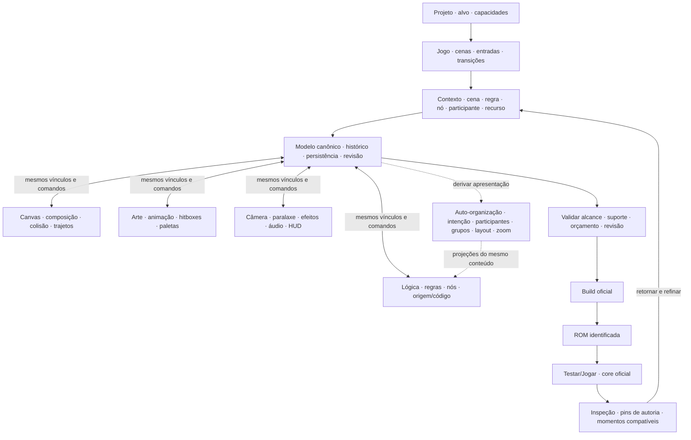

# Plano — autoria integrada, potencial criativo e auto-organização da engine

**Revisão de 24/11/2026.** A [seção 11](#workspace-modular) especifica a mesa de edição, avalia as 24 propostas de interface e define a primeira jornada de implementação, do quadro de animação à ROM.

O [prompt para o agente implementador](../handoffs/PROMPT_IMPLEMENTACAO_UX_CONTEXTUAL_R3_2026-11-05.md#prompt-entrega-integral-workspace) acrescenta as nove ferramentas de produção e reúne o escopo, a ordem de execução e as provas para entrega.

Para a conferência visual, consulte o [registro dos 12 mockups de Porto das Lanternas](#referencia-visual-20261124), com o índice, os locais de recuperação e o manifesto de integridade.

**Status: diretriz de produto registrada; proposta técnica/visual para validação do operador, antes da implementação.** Pedidos de 2026-11-08. Foco atual de implementação: Mega Drive. Esta entrega contém avaliação, plano e mockups. Nenhuma capacidade abaixo foi implementada por esta tarefa, nenhum projeto de jogo foi reorganizado e nenhuma validação de runtime é inferida das imagens.

## 1. Objetivo e alcance

Acrescentar ao RetroDev Studio uma capacidade de autoria que identifique e organize visualmente a lógica de qualquer projeto compatível a partir dos modelos, nós e relações existentes. A engine/editor deve associar automaticamente **intenção, participantes, gatilho, condição, efeito e origem**. O template de plataforma e o herói são casos de teste e exemplos de exibição; não determinam o algoritmo.

A melhoria pertence ao editor/modelo de autoria do produto. Não requer um segundo motor de execução, um compilador novo ou regras especiais para Player, Nalu, uma ROM, nome de arquivo ou gênero de jogo. “Qualquer projeto compatível” não significa interpretação universal de código arbitrário: o reconhecimento é limitado pela semântica disponível, com desconhecidos explícitos.

Preservar a navegação global à esquerda, a navegação horizontal de contexto, acesso a todas as ferramentas, o grafo completo, parâmetros numéricos, conexões, condições, ramificações, trajetos e liberdade de composição. As vistas propostas são projeções dos mesmos dados. Não transformar o editor em uma lista de cartões que substitua a edição precisa.

**Esclarecimento do operador em 2026-11-08:** a melhoria deve organizar o processo de produção em situações diversas e continuar aberta à composição. Zoom é somente uma forma de leitura. O alcance obrigatório inclui o fluxo completo de cenas do jogo e ações intercambiáveis entre lógica, gráfico específico, Canvas e teste em tempo real, preservando contexto e dados. Os exemplos reconhecidos não formam uma lista fechada de mecânicas permitidas; associação parcial limita o resumo, não o acesso à lógica e às ferramentas já suportadas.

Esta proposta complementa R2/R3 e a direção R5/R7 da [jornada de autoria](JORNADA_MEGA_DRIVE_2026-11-05.md). Sua execução futura deve entrar na frente sequencial vigente, respeitar a [retomada](../handoffs/PROMPT_RETOMADA_COESAO_PRODUTO_2026-10-24.md) e o [prompt integral existente](../handoffs/PROMPT_IMPLEMENTACAO_UX_CONTEXTUAL_R3_2026-11-05.md), após validação deste plano. Não iniciar esta implementação nesta rodada.

### 1.1 Diretriz de produto registrada pelo operador

**Pedido de registro detalhado, 2026-11-08:** levar o RetroDev Studio a uma engine com excelente potencial criativo, capaz de aproveitar amplamente os consoles retrô, com **Mega Drive como foco atual de implementação**. As ferramentas devem unir flexibilidade e robustez a uma organização moderna, ajustável e interligada, voltada à produtividade e à coesão do projeto. A experiência deve ser concebida prioritariamente para pessoas leigas, permitindo aprender e produzir enquanto aprofundam o domínio técnico, conservando acesso à autoria avançada.

O resultado pretendido é um ambiente em que o autor consiga imaginar, compor, programar visualmente, testar, compreender o resultado, refinar e entregar jogos elaborados. A engine assume o trabalho repetitivo de associação, rastreamento e organização; o autor conserva decisões de arte, mecânicas, composição e técnicas. Qualidade visual, qualidade de execução e qualidade da experiência de produção são exigências simultâneas.

Esta diretriz é o objetivo do plano e o critério para avaliar os incrementos. Seu registro não declara essas capacidades prontas, não substitui o roadmap operacional e não autoriza começar implementação nesta tarefa documental. A situação dos cinco mockups permanece de proposta a validar.

### 1.2 Foco atual e significado de aproveitar o console

O fechamento desta direção será perseguido primeiro no **Mega Drive**, pelo pipeline e pelos owners oficiais existentes. Recursos já suportados de outros alvos devem conservar suas regressões; sua existência não transfere comprovação para MD nem autoriza ampliar frentes em paralelo. A arquitetura preserva a separação entre autoria e capacidades específicas do alvo, para evolução posterior conforme o roadmap, sem impor limites artificiais de um console aos demais.

“Uso maximizado do potencial” significa ampliar a variedade e a qualidade dos resultados que o autor consegue produzir dentro das capacidades reais, com custo conhecido e desempenho adequado ao jogo. Não significa ocupar toda a memória, consumir toda a janela de transferência, empilhar efeitos ou perseguir um percentual fictício de aproveitamento. Reservas, estabilidade e técnicas alternativas fazem parte da qualidade. Um recurso isolado funcionar não prova que a combinação de recursos ou a cena de maior carga funciona.

O inventário deve relacionar, conforme suporte efetivo, composição de planos e sprites, tiles e mapas, prioridades, paletas e suas mudanças, câmera/rolagem/paralaxe, animação, colisão, mecânicas, efeitos e áudio aos respectivos custos e restrições. Considerar CPU, memória, recursos do VDP, transferências por quadro e cadência do conteúdo, com os [limites de hardware canônicos](../04_HARDWARE_SPECS.md) e medições identificadas. Valores e técnicas não comprovados ficam como pendência por alvo. Não introduzir promessas de transparência, streaming ilimitado, hot reload universal ou equivalência de técnicas entre consoles.

### 1.3 Objetivos verificáveis e vínculo com a série

| ID | Objetivo | Direção para ferramentas e experiência | Evidência para considerar atendido | Série principal |
|---|---|---|---|---|
| **OBJ01 — Liberdade criativa** | Permitir composição autoral diversa e mecânicas elaboradas. | Nós livres, regras combináveis, parâmetros precisos, estados/variáveis, cenas e recursos reutilizáveis; receitas servem de ponto de partida. | Produzir e reabrir casos distintos, inclusive começando pelos nós, sem depender de nomes/templates ou perder customizações ao voltar à jornada. | S01, S03–S06, S08 |
| **OBJ02 — Potencial do Mega Drive** | Tornar técnicas e custos reais utilizáveis na produção. | Ferramentas visuais para composição, planos/prioridade, paletas, câmera/paralaxe, trajetos, efeitos e recursos de áudio dentro do suporte; orçamento acessível perto da tarefa. | Combinações representativas e situações de maior carga no Build→ROM→core oficial, com identidade, cadência e custos medidos; limites restantes registrados por técnica. | S00, S03–S05, S07, S09–S10 |
| **OBJ03 — Gráficos e apresentação de qualidade** | Preservar a intenção artística até o console. | Pixel art, montagem e conversão adequadas, animações, paletas/usos/variantes e prévia pertinente; conservar originais e permitir revisão do resultado. | Comparar fonte, conversão, composição e resultado na ROM; verificar transparência/índices/bancos/quadros conforme o alvo, sem substituir qualidade por placeholders ou por uma imagem sintética bonita. | S04, S07, S09–S10 |
| **OBJ04 — Ferramentas robustas** | Tornar edição precisa, reversível e recuperável. | Gesto e número na mesma propriedade, escopo explícito, Undo/Redo, cancelamento sem efeito, persistência/recuperação e tratamento de conflitos. | Repetir editar→desfazer/refazer→salvar→fechar/reabrir e negativos pertinentes; provar ausência de perda e de alteração silenciosa em recursos compartilhados. | S00–S01, S03–S05, S08, S10 |
| **OBJ05 — Coesão e interligação** | Fazer o projeto se comportar como um conjunto coerente. | Jornadas, regras, grafo espacial, mapa de cenas, Arte e Canvas usam os mesmos vínculos; ações diretas abrem o recurso/propriedade certos e oferecem retorno. | Edição em ambos os sentidos, revisão consistente, transições com origem rastreável e ausência de cópias divergentes, campos antigos ou dados em outro alvo. | S01–S02, S05–S06, S08–S10 |
| **OBJ06 — Amigável para leigos** | Permitir produzir e compreender sem dominar previamente termos de hardware/programação. | Linguagem de tarefa, exemplos úteis, ações descobríveis, ajuda contextual, erros com correção e detalhe técnico progressivo; acesso avançado permanece disponível. | Pessoas do público pretendido conseguem localizar, editar, testar, corrigir e retomar tarefas, com observação de hesitações/erros e sem condução contínua do avaliador. | Todas; fechamento humano em S10 |
| **OBJ07 — Organização moderna e adaptável** | Reduzir esforço de orientação e arrumação conforme o projeto cresce. | Associação automática por semântica, layout incremental estável, foco/busca, painéis ajustáveis, navegação global e níveis de leitura com acesso integral. | Comparação com a tela atual em grafos representativos, preservando conexões, autoria, títulos/fixações e acesso; validar janela pequena, teclado, contraste e movimento reduzido. | S02, S06, S08, S10 |
| **OBJ08 — Produtividade sustentável** | Encurtar o ciclo criativo sem comprometer a confiança. | Automatizar conversões/associações repetitivas suportadas, mostrar impacto, oferecer prévia/cancelamento quando cabíveis e integrar editar→testar→refinar→entregar. | Medir tempo até resultado verificável, ações repetidas, correções, retorno e reabertura; reproduzir o artefato da revisão correta em uso prolongado. | S04–S06, S08–S10 |

Nenhum objetivo recebe aceite global apenas por existir um botão ou uma demonstração curta. A matriz canônica deve indicar owner, alvo, suporte, evidência e dependências; a matriz acima descreve a intenção e o aceite do plano, sem criar outro registro de maturidade.

### 1.4 Contrato de qualidade para cada ferramenta/lote

Antes de implementar cada lote, registrar na entrada correspondente do plano/handoff existente:

1. **Intenção e descoberta:** o que a pessoa quer realizar, como encontra a ação e que resultado reconhecível espera; evitar exigir uma sequência de termos internos para começar.
2. **Autoria e alcance:** tipo de objeto/recurso compatível, identidade/ocorrência, owner, propriedade, unidade, escopo local/compartilhado e quem será afetado.
3. **Manipulação completa:** operação visual e numérica quando pertinentes, seleção inclusive de conteúdo encoberto, ajuste fino, composição e caminho para detalhes avançados.
4. **Integração:** como a mudança aparece em jornada, regra, nós, Arte/Canvas e mapa de cenas quando aplicável, com leitura atualizada e escrita vinculada nos dois sentidos.
5. **Segurança de edição:** momento de confirmação, cancelamento, Undo/Redo, erro/conflito, salvamento, reabertura e recuperação pelos mecanismos existentes.
6. **Custo e execução:** suporte real no Mega Drive, custo previsto e medido, limites/alternativas e política de prévia, atualização ao vivo ou reconstrução. Limitação importante deve aparecer antes de perder trabalho.
7. **Carga cognitiva e acesso:** informações essenciais na tarefa, detalhes sob demanda, contexto/retorno conservados, painel ajustável, teclado/contraste e comportamento em janela pequena. Não usar recolhimento automático para esconder um campo em edição ou avisos relevantes.
8. **Prova e continuidade:** cenário positivo, negativo/regressão pertinente, recursos do host, jornada no Tauri quando houver mudança de comportamento, ROM/core quando alcançar execução, resultados/limites e próximo incremento.

Automação deve ter intenção clara e resultado inspecionável, usando os comandos canônicos e respeitando personalizações. Não alterar arte, paleta, colisão, prioridade ou lógica silenciosamente em nome de desempenho/organização. Oferecer alternativas explicadas e aplicar apenas a mudança escolhida ou já autorizada, com reversão compatível.

### 1.5 Experiência pedagógica e avaliação de produtividade

A pessoa leiga deve poder seguir uma jornada curta com ações em linguagem de produção: montar cena, escolher participante, definir ação, editar gráfico, testar resultado. Cada passo revela o trecho correspondente no grafo e ensina a relação entre intenção e funcionamento. Ela pode interromper essa jornada, navegar livremente, aprofundar nos nós e voltar; não fica presa a um assistente linear ou a um modo com menos capacidade.

Ajuda e exemplos devem acompanhar a seleção e explicar efeito, alcance e como corrigir problemas. Unidades e termos técnicos necessários recebem explicação contextual. Estados vazio, carregando, parcial, removido e erro têm próximo passo claro, conservando dados. A primeira tarefa deve oferecer um resultado verificável; o mesmo ambiente deve suportar projeto maior, refinamento de qualidade e manutenção repetida.

Para avaliar, levantar linha de base e repetir tarefas comparáveis: tempo até primeiro teste válido, quantidade de ações, mudanças de contexto, busca por ferramentas, erros de alvo/escopo, recuperação após erro e perda de orientação. Medir separadamente latência da interface, tempo de build, cadência da execução e compreensão humana. Definir metas após a linha de base, sem inventar percentuais de ganho ou declarar usabilidade aprovada por testes automatizados. A aprovação final exige evidência técnica e avaliação com o público pretendido.

## 2. Avaliação da tela real e da base disponível

Referência visual: captura enviada pelo operador, com 37 nós e grupos cujo propósito é difícil de reconhecer no zoom apresentado. Quantidades são da captura, não uma medição nova de execução. A mesma miniatura de personagem aparece em lógicas com funções distintas; os fundos coloridos não explicam quem consulta ou modifica cada participante. A malha pontilhada domina a visão geral e os títulos ficam pequenos.

Na fonte pesquisada, já existem peças úteis:

| Fonte/owner | O que existe | Lacuna a tratar na engine/editor |
|---|---|---|
| `src/core/nodegraph/nodeCatalog.ts` e `nodeDefinitions.ts` | Catálogo único, categorias, ícones, nomes e definição dos nós | Descrever papéis semânticos dos parâmetros/portas de cada tipo suportado: alvo, leitura, escrita, recurso, gatilho e efeito. Não inferir o papel só pelo texto do nome. |
| `src/core/nodegraph/ruleSummary.ts` | Resumos Quando → Se → Fazer, IDs de nós e tratamento explícito de fluxos avançados | Reutilizar e ampliar a projeção para participantes, nomes amigáveis, relações entre regras e origem; não apresentar resumo parcial como completo. |
| `src/core/nodegraph/behaviorLibrary.ts` | Receitas, instâncias, papéis, parâmetros e assinaturas de nós gerados | Usar essas informações como origem declarada das associações, sem recriar receitas ao interpretar a imagem do grafo. |
| `src/core/nodegraph/nodeTypes.ts` | Grupo visual com id, label, nodeIds e collapsed; identidade de nós/arestas | Preservar identidade e metadados de autoria. Resolver separadamente relações derivadas, escopo e personalizações visuais. |
| `src/components/nodegraph/NodeGraphEditor.tsx` | Agrupar, nome sugerido, recolher, mover grupo, enquadrar e navegar para o alvo | O nome sugerido depende da seleção e de heurísticas simples; o cabeçalho reduz altura conforme o zoom. Criar identidade legível persistente e associação automática nos fluxos de construção. |
| `src/core/nodegraph/nodeLayout.ts` | Layout, ocupantes recolhidos, pins, conflitos e `graphSemanticSignature` | Estender a organização incremental por relações/grupos, preservando a defesa já existente de não alterar lógica. |
| `studioContext`, `editorStore`, contexto/origem da entidade e renderer da cena | Seleção, contexto, retorno e apresentação da cena | Ligar regra ↔ participantes sem outro sistema de seleção, outra cena ou carregamento sem limite de assets. |

Observação de fonte: a sugestão atual chega a reconhecer objetivo procurando `goal` no parâmetro e pulo pela presença de velocidade vertical negativa. Isso é útil como ponto de partida, mas não deve virar contrato genérico. Renomear um objeto ou combinar duas regras não pode mudar arbitrariamente a intenção reconhecida.

O workspace contém mudanças de outra frente em fontes de produto e em documentos compartilhados. Elas permanecem preservadas. A leitura começou em `1c5f404f`; durante a avaliação a continuidade avançou a `014e299fad9cc20d1cedef780b4f50be7f219418`. Revalidar o estado antes de qualquer implementação futura. Este plano não certifica essas mudanças.

## 3. Contrato da associação automática

### 3.1 Uma origem, uma projeção

Derivar a descrição do grafo/modelo canônico. A projeção pode ter cache por revisão, mas não é outro grafo de execução nem outra fonte de parâmetros. Usar os resolvers existentes para projeto, cena, grafo, instância/modelo e recurso; não deduzir escopo pela miniatura.

Cada regra/grupo apresenta, quando conhecido:

- **Título de intenção:** ação compreensível, com participante quando útil; título personalizado pelo autor tem precedência.
- **Definida em:** contexto/origem real da regra, distinto dos objetos afetados.
- **Quando / Se / Faz:** gatilho, condições e efeitos sustentados pelo modelo.
- **Afeta:** entidades, recursos, variáveis ou serviços modificados.
- **Consulta / depende de:** entidades, estados, colisão, variáveis e recursos lidos.
- **Origem:** declaração/receita, descrição derivada do grafo ou associação parcial/não confirmada.
- **Identidade navegável:** referências existentes de grafo/nós/grupo para localizar o conteúdo, sem trocar IDs por nomes visuais.

Um grupo pode pertencer à lógica de um personagem e afetar porta, câmera ou áudio. Miniaturas representam os participantes pertinentes, inclusive mais de um; não repetir sempre o sprite dono do arquivo. Áudio, câmera, variável e recurso sem imagem recebem representação do seu tipo e nome, sem inventar um sprite. Ausência de asset não impede identificar a regra.

### 3.2 Precedência de reconhecimento

1. **Origem declarada:** metadados válidos de receita, binding ou modelo de objeto, inclusive dados de trajeto quando esse for o owner. Nomes/participantes são derivados dessa origem conhecida.
2. **Descrição do grafo:** analisar tipos/portas/parâmetros conhecidos e os caminhos de execução/dados. Uma descrição é reconhecida por estrutura e semântica tipada, não por nomes de personagens ou do projeto.
3. **Parcial:** conservar as partes conhecidas e indicar lacunas, múltiplas entradas, participantes indefinidos e efeitos que não podem ser resumidos. Dar acesso ao grafo completo, sem forçar uma classificação.

Origem de uma associação e suporte de execução no alvo são informações distintas. Um trajeto declarado ou nó importado não recebe selo de efeito em runtime só por aparecer num cartão. Não introduzir percentuais fictícios de confiança ou usar animação visual do editor como telemetria do core.

### 3.3 Construção e uso repetido

| Situação | Comportamento planejado |
|---|---|
| Adicionar comportamento conhecido | Criar/atualizar identificação e grupo visual com os participantes e a origem da receita, na mesma ação de autoria. |
| Acrescentar/conectar nó manual | Recalcular a região afetada e atualizar a descrição. Associação incerta fica como sugestão/parcial; não mover nós deliberadamente posicionados por causa de uma hipótese. |
| Renomear objeto/recurso | Atualizar os nomes derivados por identidade. Preservar o título personalizado da regra. |
| Abrir projeto antigo | Oferecer projeção útil imediatamente, sem gravar a lógica ou migrar silenciosamente o projeto. A adoção de organização visual persistida é explícita e reversível. |
| Nó usado por várias regras | Mostrar referências/dependências compartilhadas. Não duplicar o nó ou a execução para que ele caiba em dois cartões. |
| Recolher, dar zoom ou filtrar | Alterar somente a apresentação. Não pausar a lógica, remover caminhos, trocar parâmetros ou reescrever a intenção. |
| Fixar posição ou personalizar título | Respeitar a autoria nas reorganizações seguintes. Uma opção explícita pode voltar ao nome/layout automático. |
| Remover participante ou trocar contexto | Invalidar a associação correspondente, conservar o dado desconhecido e descartar resultados atrasados de outra cena/revisão. |

## 4. Organização espacial e níveis de leitura

**Automático para conteúdo novo:** aproveitar a ação de criação/conexão/receita para posicionar novos blocos na região adequada, evitar sobreposições e estabelecer um título/associação. Reutilizar `layoutNodeGraph`, pins, caixas recolhidas e o histórico existentes.

**Estável para trabalho existente:** a engine não reorganiza tudo a cada tecla, frame, seleção ou rename. Conservar posições manuais/pins. Se um novo bloco não couber sem mexer no trabalho fixado, indicar o conflito e oferecer organizar a seleção/grupo. Organizar tudo continua uma ação explícita com Undo. Não sobrescrever grupos manuais com categorias inferidas.

**Vistas do mesmo grafo:**

- Fluxo do jogo: cenas, entradas, transições, bifurcações, retornos e destinos dinâmicos/pendentes identificados, com acesso ao nó/objeto responsável.
- Visão geral/mapa de regras da cena: intenção, participantes, gatilho/efeito e origem legíveis; busca e minimapa representam grupos com nomes.
- Visão intermediária: condições, ações principais, relações de dados e fronteiras entre grupos.
- Grafo completo/detalhe: todos os nós, campos, portas, ramificações, ciclos e conexões editáveis.

O zoom semântico adapta a densidade de informação; não é gravar `collapsed` ou apagar componentes ao afastar. Cabeçalhos mantêm legibilidade dentro do espaço disponível e a malha perde contraste. Em grafos grandes, priorizar seleção/foco/busca e usar agregação do minimapa; não prometer exibir centenas de títulos simultaneamente em 949×593. Preservar pan/zoom, retorno e acesso a todos os itens. Na implementação, o minimapa deve refletir limites geométricos e a área visível; uma lista navegável de grupos deve ser identificada como índice, sem simular um mapa espacial.

Cores e miniaturas são apoios; a relação textual e os participantes sustentam a compreensão. A vista detalhada mantém precisão. Se nó e Inspector exibirem o mesmo parâmetro, compartilhar o valor/modelo, indicar a superfície ativa de edição e evitar dois drafts concorrentes.

Painéis contextuais mantêm cabeçalho/ícone e acesso visíveis quando recolhidos, com abrir, fixar e restaurar disposição. A seleção determina o conteúdo, sem fechar um campo em edição ou depender apenas de hover; teclado e movimento reduzido têm caminhos equivalentes. Uma miniatura da cena ajuda a orientação; marca d'água atrás do grafo é opcional, com opacidade controlável e desativada quando prejudicar contraste. Referências de exibição como A1/A2 podem acompanhar cena/regra por vínculo estável, sem substituir IDs ou mudar de significado ao reorganizar os nós.

### 4.1 Tela de nós como autoria completa e integrada

**Correção explícita do operador em 2026-11-08:** conservar a tela espacial de nós da captura, robustecida e integrada às vistas pedagógicas. Trabalhar individualmente pelas jornadas deve resultar em organização automática nessa tela; editar nela deve atualizar as outras representações. A preocupação central é reduzir sobrecarga cognitiva preservando criatividade, capacidade e precisão.

O grafo continua uma superfície de trabalho livre: criar/conectar/remover nós e portas conforme o modelo, ajustar parâmetros, combinar regras, percorrer branches/ciclos e manipular grupos no espaço. Não o substituir por uma sequência vertical de cartões ou por diagramas fechados. Mapa do jogo, jornadas/formulários, composição e grafo são perspectivas complementares; não são cópias do projeto nem níveis de permissão “iniciante/profissional”. O usuário pode começar pelos nós.

Ao criar por uma jornada, a mesma ação canônica estabelece referências e, quando a semântica permitir, associação/grupo e posição inicial dos novos nós. A organização existe durante a construção, sem exigir uma campanha posterior de arrumação. Criar diretamente no grafo aciona a mesma análise incremental: reconhecer o que for sustentado pelo modelo, preservar o desconhecido e não mover o trabalho manual para fazê-lo caber numa categoria. Uma jornada pode envolver vários grupos; um grupo pode reunir participantes distintos e depender de outra regra sem duplicar execução.

### 4.2 Contrato de edição em ambos os sentidos

“Sincronizar” significa ler e comandar a mesma autoria pelos owners existentes, não converter repetidamente dois documentos independentes. Identificar por campo o owner, ID/ocorrência, escopo, unidade, revisão, comando de escrita e correspondência verificável. `ruleSummary` já carrega `nodeId` para editar parâmetros na origem; `behaviorLibrary` também guarda parâmetros de receita e assinaturas geradas. Esse segundo caso exige reconciliação explícita, pois o código atual de `planEditBehavior` pode regenerar nós e apresentar conflitos com edições manuais. Esses mecanismos são base a integrar, não prova de round-trip integral já implementado.

| Alteração de autoria | Reflexo obrigatório nas demais perspectivas | Proteção necessária |
|---|---|---|
| Alterar um parâmetro na jornada/formulário | O nó vinculado e o resumo mostram o novo valor/unidade, mantendo identidade e caminhos. | Comando no owner e atualização do trecho necessário; não regenerar todo o grafo ou sobrescrever conexões personalizadas para mudar um campo. |
| Alterar o mesmo parâmetro no nó | A jornada/Inspector correspondente lê o valor atual. | Não exibir o valor antigo da receita como se fosse vigente. Se a correspondência não for reversível, identificar o campo como personalizado/com origem no grafo, sem inventar outro valor. |
| Criar/reconectar lógica no grafo | Resumos, dependências, participantes e mapa de cenas são reavaliados no alcance pertinente. | Identificar trecho parcialmente representável e permitir abri-lo no grafo. Preservar o trecho e os controles ainda válidos; não forçar a regra a voltar à receita inicial. |
| Alterar um destino de cena | A ligação no mapa e o nó de origem refletem a mesma referência. | Destino dinâmico/parcial explícito; mover o cartão da cena no mapa não altera a transição. |
| Editar arte/animação/paleta ou propriedade no Canvas | Recursos e valores vinculados são reapresentados nas vistas que os usam. | Mesmo recurso/ocorrência e alcance compartilhado; posição inicial, destino de ação e estado observado continuam distintos. |
| Mover/recolher/filtrar grupos, dar zoom ou navegar | Atualizar somente preferências de apresentação pertinentes. | Não mudar lógica, posição dos objetos na cena, execução ou estado dos painéis de outra perspectiva sem intenção explícita. |
| Desfazer/refazer, salvar/reabrir ou recuperar | Todas as perspectivas mostram a revisão autoral resultante. | Usar os históricos/transações e persistência dos owners; uma ação semântica não gera várias ações independentes que exigem desfazer vista por vista. |

Uma topologia arbitrária não precisa caber integralmente num formulário simples. O contrato exige **fidelidade e acesso**, com representação parcial explícita, e não uma equivalência falsa entre qualquer grafo e qualquer receita. Para uma receita personalizada, uma escrita incompatível não pode regenerar/destruir os nós silenciosamente; deve permitir continuar no grafo e resolver somente o conflito real. A marcação de alteração manual precisa distinguir edição externa de uma atualização legítima feita pelo próprio comando vinculado, cobrindo a regressão JV09 já identificada.

As mudanças confirmadas de autoria invalidam as projeções por revisão; rascunhos, cancelamento e erro não publicam um estado parcialmente aplicado. Resultados atrasados não substituem outra revisão/projeto. Atualizar as vistas de edição não equivale a atualizar a ROM em execução: mantém-se o contrato de teste da seção 5.3. Não introduzir um novo motor de sincronização, store global, grafo paralelo ou interpretador universal.

### 4.3 Redução de sobrecarga cognitiva sem restringir autoria

- **Uma tarefa em primeiro plano:** grafo ocupa a área central na perspectiva Nós; Inspector acompanha a seleção. Mapa de cenas, prévia e biblioteca abrem quando pedidos, com alternativa de fixação, sem mostrar todos os espaços simultaneamente por padrão.
- **Orientação persistente e compacta:** projeto/cena/regra e acesso global permanecem visíveis. Título, participantes e origem explicam os grupos; não exigir decifrar cor ou miniatura para descobrir uma função.
- **Detalhe por intenção:** iniciar com enquadramento útil; buscar/enquadrar seleção ou grupo; revelar campos e conexões pertinentes sem remover acesso ao restante. Foco visual atenua o entorno, mostra relações externas e permite restauração imediata; não desliga lógica nem esconde defeitos para validar.
- **Estabilidade espacial:** organização incremental resolve conteúdo novo. Nós fixados, nomes, arranjo manual, pan/zoom e retorno sobrevivem; reorganizar o existente é ação deliberada e reversível. Não saltar a vista após cada edição.
- **Sinais com prioridade:** seleção e erro pertinente têm destaque, malha e relações não selecionadas ficam discretas; distinguir execução e dados também por forma/legenda. Diagnóstico detalhado fica acessível, com indicação persistente de pendências relevantes, sem empilhar todas as mensagens sobre o grafo.
- **Edição direta e descoberta:** ações comuns próximas do alvo, atalhos/menu contextual com alternativas visíveis, nós/código e catálogo completo ao alcance. Nenhuma lista de mecânicas reconhecidas define o que o autor pode criar dentro das capacidades reais.
- **Densidade ajustável:** painéis redimensionáveis/recolhíveis/fixáveis, nomes acessíveis, teclado, contraste e movimento reduzido. Em janela pequena, usar o painel contextual existente e uma superfície ativa por vez, preservando acesso e valor; não tentar miniaturizar tudo.

O mockup espacial é a vista de referência para autoria por nós; as outras imagens mostram perspectivas complementares. Não é necessário mantê-las abertas juntas para obter a sincronização.

## 5. Navegação entre regra, cena e dados

- Clicar na regra enquadra seu conjunto de nós; abrir detalhe preserva a identidade selecionada.
- Ver participantes na cena destaca exatamente o que a regra consulta/afeta. Não pressupor que é sempre o herói. Escolher entre múltiplos alvos quando necessário.
- Selecionar um objeto na cena permite localizar regras que o modificam e regras que o consultam, com essas relações distintas.
- Busca por título, participante, efeito, recurso e identidade já suportada leva à ocorrência correta, incluindo grafos compartilhados. Não criar outra numeração instável nem misturar instâncias iguais pela aparência.
- A lista Participantes do mockup é um filtro contextual. Não substitui a hierarquia da cena nem a navegação global.
- Relações entre grupos distinguem fluxo de execução e dependência de dados. Uma linha de “lê variável” não se torna uma aresta executável nova.
- Duplo clique abre a edição principal do recurso compatível. Botão direito oferece ações sobre aquela seleção: arte/animação, paleta/usos, lógica/comportamento, Canvas/isolamento e teste, conforme suporte e escopo. O mesmo conjunto tem acesso por teclado e botão de ações; não esconder operações exclusivamente no menu contextual.

O grafo/contexto selecionado é um recorte de trabalho, não o limite de cobertura da entrega. O fluxo integral do jogo e o acesso aos demais grafos fazem parte do aceite. Resolver e carregar de forma progressiva, com escopo e orçamento limitados; mostrar o que está sendo indexado, o que é conhecido e o que está indisponível. Não carregar todos os assets/grafos de uma vez nem usar um índice persistido concorrente para simular cobertura. Lote parcial não conclui esta proposta enquanto esse acesso integral não existir.

### 5.1 Fluxo completo do jogo e das cenas

Oferecer acesso permanente às escalas **Cenas do jogo → Regras da cena → Grafo completo**, sem perder as áreas globais ou a liberdade de abrir outras relações. A escala do jogo representa entradas, cenas de menus/fases/outros tipos compatíveis, bifurcações, retornos, ciclos e encerramentos; não pressupor uma sequência linear de fases. Cada ligação indica sua origem, gatilho/condição e destino quando conhecidos, com navegação para a regra e o nó responsáveis.

Transição declarada, execução suportada no alvo e transição observada em teste são fatos diferentes. Destino calculado, ausente, externo ou não compreendido permanece explícito e inspecionável. A auto-organização não pode eliminar essas rotas nem apresentar só os caminhos reconhecidos como se fossem o jogo completo. O mapa deriva dos modelos/grafos/provenientes existentes; não cria outro executor ou reescreve transições ao mover cartões.

### 5.2 Ações intercambiáveis entre esteiras de trabalho

Uma seleção estabelece vínculo de autoria com projeto/cena/revisão, grafo/nó, participantes, recurso, animação/ocorrência e propriedade espacial pertinentes. O vínculo deve ser resolvido pelo modelo e reutilizar `studioContext`, seleção, retorno, persistência e histórico existentes. A identidade do recurso afetado pode ser diferente da entidade dona do grafo.

| Intenção a partir da lógica | Destino direto planejado | Conservação obrigatória |
|---|---|---|
| Editar o gráfico usado por uma ação | Abrir o asset/variante exatos na Arte; para ação de animação, abrir também o estado/ocorrência correspondente quando conhecidos. | Não abrir sempre o gráfico do dono do arquivo. Se houver vários recursos, oferecer escolha contextual com nomes/miniaturas; escopo compartilhado e usos claros antes de gravar. |
| Editar paleta, áudio ou outro recurso | Abrir o owner/ferramenta apropriados daquele recurso e das ações efetivamente suportadas. | Um recurso global não recebe posição ou sprite fictícios; preservar as operações e limites reais do seu tipo. |
| Posicionar o objeto | Enquadrar e selecionar o participante correto no Canvas, com manipulação visual e entrada numérica sobre a mesma fonte. | Preservar autoria inicial, prioridade/plano, colisão e histórico conforme o campo editado; nome e aparência não substituem identidade. |
| Ajustar posição/destino de uma ação | Abrir no Canvas a alça/vetor/trecho correspondente ao parâmetro da ação, trajeto ou câmera. | Distinguir posição inicial da cena, destino do comando e posição observada em execução. Arrastar o destino de um nó não pode mover silenciosamente o spawn inicial. |
| Testar a partir do contexto | Acionar a sessão oficial do contexto/cena/destino validado, mantendo todos os participantes e dependências. | Identificar revisão, início e ROM; não apresentar um objeto isolado ou ROM antiga como teste atual. |
| Voltar à lógica | Retornar à mesma regra/nó com seleção, pan/zoom, painéis e edição preservados. | Mudanças na Arte/Canvas já aparecem na referência/resumo pertinente, sem duplicar dados ou reiniciar a associação. |

Essas ações devem estar próximas da seleção e disponíveis por teclado. As áreas continuam abertas à navegação livre; o contexto oferece caminhos diretos e retorno, não aprisiona o usuário numa sequência fixa. Em conflito, recurso removido ou resposta atrasada, usar os estados de recuperação existentes, sem trocar o alvo silenciosamente.

### 5.3 Edição e teste em tempo real

O requisito é um ciclo integrado de **editar → observar → testar → ajustar → continuar**, aproveitando a direção R6/Jogar e o core oficial existente. Inclui resposta imediata das ferramentas de autoria, acesso direto ao teste a partir da seleção e experiência de execução na frequência apropriada do conteúdo, com controle/áudio e cadência medidos. Não se reduz a mostrar um arco ou uma animação de prévia.

Definir por propriedade/alvo o contrato de atualização: o que pode ser aplicado ao vivo com confirmação e reversão, o que é apenas prévia de autoria e o que exige preparar/reconstruir/reiniciar a execução pelo pipeline oficial. Essa tabela deve integrar o suporte existente, não criar um segundo runtime. Mudanças estruturais que exijam build usam uma ação integrada de preparação, preservando o trabalho; não pedir que o usuário refaça toda a navegação.

A interface identifica **edição atual**, **execução da revisão identificada**, **alterações pendentes** e **preparando atualização**. Nunca chamar uma prévia de execução real nem uma ROM desatualizada de revisão atual. Não prometer hot reload irrestrito para todo tipo de dado. Atualização ao vivo, quando suportada, deve manter correspondência entre modelo, recurso/runtime, Undo e recibo da revisão; evitar alterações de RAM avulsas sem contrato de autoria.

Os owners de teste incluem shell/comandos, `buildService`, IPC/build canônico, emulador e `runtimeLink`; o último identifica a execução, não substitui o pipeline. Testar ↔ Jogar ↔ editar reutiliza a sessão quando compatível e a recuperação/retorno existentes. A cadência de gameplay e a latência de interação precisam ser medidas no alvo; nenhum selo de tempo real é concedido por um mockup.

## 6. Roadmap em série — da base ao ambiente completo

**Pedido complementar de 2026-11-08:** apresentar a ordem de construção e verificar se ela resulta numa experiência robusta, dinâmica e amigável, com a lógica integral estruturada. A série S00–S10 detalha as etapas 0–5 anteriores e incorpora a cobertura já solicitada em R2/R3/R5/R6/R7. Não substitui os estados operacionais do roadmap canônico nem declara capacidades implementadas por este documento.

### 6.1 Sequência de implementação

A ordem abaixo é de construção da engine/editor. No produto resultante, o usuário pode iniciar por diferentes áreas e alternar livremente entre as esteiras. A passagem de fase exige o aceite correspondente, com as regressões do owner e a jornada afetada; uma retenção não pode ser escondida por uma interface nova.

| Série | O que precisa ser fechado | Experiência de produção resultante | Gate para avançar |
|---|---|---|---|
| **S00 — Conservar e estabilizar** | Conferir capacidades existentes, WIP, bugs abertos, owners, suporte por alvo, recursos do host e evidências. Integrar os fechos já em andamento antes de ampliar as mesmas responsabilidades. | O usuário mantém funções, precisão, projetos e caminhos que já possuía. | Matriz função→acesso→owner→regressão→prova; falhas preexistentes identificadas; baseline correspondente. Não reiniciar o produto do zero. |
| **S01 — Uma base de autoria** | Identidades, escopo, recurso compartilhado, unidades, contexto, persistência, Undo/Redo, revisões e descritores semânticos dos tipos de nó. | Arte, Canvas, lógica e execução referem os mesmos objetos/recursos e os valores corretos. | IDs/legado/overrides preservados, cancelamento sem mutação, conflito/recuperação corretos; descritores independentes de nomes de template. |
| **S02 — Navegação e fluxo do jogo** | Navegação global + contextual; painéis recolhíveis/fixáveis; escalas Jogo→Cenas→Regras→Grafo/origem; entradas, bifurcações, retornos, ciclos e destinos dinâmicos. | Compreender o jogo inteiro, abrir uma ligação, chegar ao seu nó e retornar, com ferramentas descobríveis. | Mapa completo dentro da cobertura declarada, indexação/ausências visíveis, origem e destino rastreáveis; painel em edição não fecha sozinho. Separar declaração, suporte de execução e observação real. |
| **S03 — Compor e manipular no Canvas** | Objetos compatíveis, seleção, transformação, campos precisos, camadas/planos A/B, sprites, prioridade, bloqueio, isolamento, câmera, colisão e regiões de evento; mostrar/atenuar/ocultar por camada e cor na visão de trabalho. | Montar a cena visualmente, selecionar inclusive conteúdo encoberto e ajustar com precisão. | Gesto e número alteram a mesma propriedade/histórico; filtros não mudam gameplay, arte ou paleta; sair do isolamento restaura a visão anterior; escopo de posição inicial/destino/estado observado inequívoco; suporte e granularidade do alvo claros. |
| **S04 — Produzir gráficos e recursos** | Arte/pixels, importação/conversão adequada ao alvo, animação, FPS/loop/onion skin, hit/hurt boxes, eventos de quadro, paletas/bancos/usos/variantes e conjuntos reutilizáveis. | Abrir o recurso específico de uma regra, editar e ver a referência atualizada na composição. | Conversão e recurso canônicos, qualidade visual revista após conversão, escopo compartilhado claro, cancelar/Undo/save/reopen corretos, orçamento e consumidores preservados; não reduzir o painel de paletas a uma faixa decorativa. |
| **S05 — Construir mecânicas e movimentos** | Comportamentos parametrizados, regras, estados/variáveis, gatilhos, interação/combate compatíveis, trajetos por pontos/retas/curvas/elipses, tempo/velocidade/espera/repetição/ida e volta. | Criar mecânicas ricas por gestos e parâmetros, aprofundando nos nós/código quando necessário. | Mesma semântica no Canvas/formulário/nós; origem gerada/manual e regeneração reversíveis; colisão, movimento e comportamento comprovados no alvo declarado. |
| **S06 — Auto-organizar sem limitar** | Identificação de intenção/participantes, grupos automáticos, layout incremental, pins/títulos manuais, zoom semântico, busca e relações de dados/execução. | Ler o conjunto e editar detalhes sem reorganização manual obrigatória ou classificação fechada de mecânicas. | Assinatura semântica preservada em operações visuais; parciais explícitos sem bloquear lógica suportada; layouts/personalizações mantidos; teste em outros projetos e nomes. |
| **S07 — Composição e ferramentas avançadas** | Oclusão/seleção de região, ondas/distorção, Fantasma com técnica explícita, timeline de propriedades/eventos, câmera/paralaxe, animação de paleta/atmosfera e mapa de custos/otimização assistida. | Elaborar gráficos e efeitos, avaliar sua composição e controlar custo/precisão. | Planner e emissores oficiais, limites por alvo, prévia identificada, efeito/restauração e orçamento comprovados; nenhuma troca silenciosa de arte, colisão ou prioridade. |
| **S08 — Conectar as esteiras** | Duplo clique/menu contextual com alternativas acessíveis; ações diretas nó→gráfico/animação exatos→propriedade no Canvas→teste→retorno; acesso livre a toda a produção. | Continuar o trabalho no objeto/recurso certo a partir de qualquer área pertinente. | Vínculo de autoria e escopo corretos, retorno ao mesmo nó/seleção/pan, ausência de draft concorrente ou alvo trocado; ensaio completo entre áreas. |
| **S09 — Testar e jogar continuamente** | Execução oficial em cadência adequada, início/cena/pin, pausa/step, momentos capturados compatíveis, revisão identificada e atualização ao vivo/reconstrução conforme o contrato. | Editar→observar→testar→ajustar→continuar com acesso direto e contexto preservado. | PLAY01–06, pipeline Build→ROM→core e transições realmente suportadas; cadência/áudio/input medidos; rejeição de estado/ROM obsoletos. Nenhuma prévia substitui essa prova. |
| **S10 — Fechar produção repetida e entrega** | Uso prolongado, regressão entre projetos/alvos declarados, acessibilidade, memória/desempenho, salvar/reabrir/recuperar e build/exportação da revisão correta. | Um ambiente confiável para produzir, revisar e entregar repetidamente. | Gates atuais, Tauri em 1366×768 e 949×593, jornadas/critérios humanos pertinentes e artefatos identificados; limitações remanescentes explícitas e maturidade honesta. |

S00/S01 alimentam todas as fases. S02 cria o acesso integral ao jogo; S03–S05 dão conteúdo e mecânicas a esse fluxo; S06 organiza os mesmos dados; S07 amplia produção visual; S08 fecha a continuidade entre áreas; S09 fecha a execução; S10 verifica o conjunto. Capacidade já comprovada é conservada e integrada, com reteste pertinente, não reimplementada por conveniência.

As ações intercambiáveis e a acessibilidade devem nascer em cada fase, mesmo antes de S08/S10. Essas fases verificam a integração completa, não autorizam deixar as anteriores isoladas ou inacessíveis. Uma ferramenta nova já nasce com entrada clara no Canvas/contexto, precisão numérica e retorno. O teste básico acompanha os lotes que o exigem; S09 fecha a experiência contínua de execução e suas diferentes intenções.

O contrato da seção 4.2 começa em S01, é aplicado por S03–S05 e verificado com organização incremental em S06 e intercâmbio em S08. Os critérios da seção 4.3 acompanham todas as fases. Não é aceitável concluir apenas jornada→grafo e deixar grafo→jornada para um lote sem compromisso de fechamento, nem exigir que a autoria aconteça primeiro no formulário.

Cada lote da série deve indicar quais objetivos OBJ01–OBJ08 atende e aplicar o contrato de qualidade da seção 1.4. Uma melhoria visual que reduza capacidade/precisão, uma técnica avançada que não seja utilizável pelo público pretendido ou uma automação que quebre a coesão retém o aceite correspondente. S00 continua prioritário: esta direção não permite saltar hardening, suporte do alvo ou dependências do roadmap para entregar uma aparência de completude.

### 6.2 Conferência de cobertura das propostas anteriores

| Família já solicitada | Onde entra na série |
|---|---|
| R3-01 escopo e paleta; R3-04 escopo do grafo; R3-05 unidades/input | S01 define o contrato; S04/S05 aplicam; S08 verifica o intercâmbio. |
| R3-02 visão derivada; R3-07 cabeçalho; R3-08 bloqueio | S02/S03 e S06; precisão, descoberta e reversão acompanham a UI. |
| R3-03 gerado/manual; R3-06 referências e origem das transições; R3-09 início de teste | S05/S06; S02/S08; S09, respectivamente. R3-10 mantém mockups/legendas honestos em todas as revisões. |
| R5 autoria robusta, trajetos, plataformas e planos/prioridade | S00 conserva/corrige a base; S03/S05 integram gestos e semântica; S07 compõe; S09/S10 comprovam o conjunto. |
| R6 PLAY01–06: contrato, execução, início/cena, pins, momentos e integração | S01/S02/S03 preparam referências e autoria; S09 fecha execução/compatibilidade; S10 faz uso repetido. Pin autoral não equivale a save state do core. |
| VIS01 inventário; VIS02 paletas; VIS03 primeiro plano/oclusão | S00; S04/S07; S03/S07. |
| VIS04 ondas/distorção; VIS05 Fantasma; VIS06 mesmos dados Canvas/nós/código | S07; S07; S01/S05/S08. Técnica e suporte do efeito são explícitos por alvo. |
| VIS07 seleção/transformação; carimbos/terrenos; colisão/regiões; timeline; câmera; atmosfera/paleta; custos/otimização | S03; S03/S04; S03–S05; S05/S07; S03/S05/S07; S07; S07/S10. As sete famílias permanecem no escopo declarado. |
| VIS08 integração, composição e prova entre capacidades | S08–S10, preservando toda a matriz de acesso, precisão e reversibilidade. |
| Grafo espacial preservado, autoria em ambos os sentidos e carga cognitiva (correção do operador) | S01 fecha vínculo/comando; S03–S05 aplicam; S06 organiza durante a construção; S08 verifica a ida/volta; S10 mede uso repetido e compreensão, inclusive começando pelos nós. |

Cada requisito deve ter status por owner e alvo na matriz canônica, sem um “concluído” global que esconda uma variante não comprovada. Recursos fora dos alvos/fases atuais permanecem identificados conforme o roadmap; desenhá-los não antecipa sua implementação. Se uma transição de cena ou técnica visual necessária não tiver suporte real, a dependência deve ser resolvida ou retida explicitamente antes de anunciar a experiência correspondente como completa.

### 6.3 Jornada de produção que o resultado precisa sustentar

1. Criar/abrir projeto e escolher o alvo, recuperando o trabalho anterior quando pertinente.
2. Estruturar o jogo/cenas e seus caminhos; abrir qualquer regra/transição, inclusive rota parcial/dinâmica.
3. Inserir/importar recursos, compor a cena e manipular objetos/planos/câmera com precisão.
4. Editar o gráfico/animação/paleta específicos, com alcance de recursos compartilhados visível.
5. Construir regras, trajetos, estados, eventos e efeitos, alternando gestos, campos e nós sobre os mesmos dados.
6. Usar a organização automática para localizar intenção/participantes, entrar no grafo completo e personalizar a apresentação.
7. A partir de uma regra, abrir Arte ou Canvas, alterar a propriedade correta, testar o contexto/revisão e voltar sem refazer a navegação.
8. Jogar/inspecionar, capturar/retomar momentos compatíveis e repetir o ciclo de refinamento.
9. Salvar/reabrir, revisar custos/limites e gerar/exportar o artefato da revisão identificada.

Essa sequência é um ensaio de ponta a ponta, não um assistente que obriga o usuário a começar pela cena ou terminar uma área antes de abrir outra. Exemplo de aceite: um nó afeta uma porta diferente do dono do grafo; abrir seu asset, editar a animação, ajustar a posição inicial ou o destino correto no Canvas, testar a cena completa, observar uma transição suportada, voltar ao mesmo nó e recuperar o trabalho após reabrir. Repetir com outro conjunto de objetos/projeto demonstra a capacidade da engine.

### 6.4 Visão lógica consolidada do ambiente

O modelo abaixo descreve relações de autoria/projeção/execução, não cria módulos executores novos. “Modelo canônico” reúne os owners já existentes, sem propor uma store universal que os substitua.



Navegação global e contexto continuam disponíveis em toda a estrutura. Resumo, grupo e minimapa organizam o acesso; o grafo completo e as origens permanecem alcançáveis. Os estados conhecido/parcial, prévia/execução e edição atual/revisão em teste continuam distintos. Implementar em série não transforma a produção em caminho único.

A aprovação visual orienta a implementação dentro da frente sequencial, respeitando fechos em andamento. Não aprova contrato ainda não testado, não muda decisões arquiteturais consolidadas e não concede merge/release/deploy.

## 7. Validação que distingue melhoria da engine de ajuste de template

Os objetivos OBJ01–OBJ08 precisam de evidência complementar: liberdade e alcance entre situações distintas; combinação de técnicas com orçamento e execução no MD; fidelidade visual após conversão; precisão/recuperação; consistência entre perspectivas; compreensão por leigos; organização em diferentes densidades; e produtividade em ciclos repetidos. Registrar resultado e retenções por objetivo/lote/alvo nos owners e documentos canônicos, conservando separados teste de unidade, jornada Tauri, ROM/core e aceite humano.

O template atual entra como **um** caso. O aceite exige também:

1. Grafo com movimento de outro tipo de objeto, sem nomes Player/Hero/Nalu e sem usar imagem como chave semântica.
2. Regra de puzzle/interruptor com leitura e escrita em participantes diferentes; câmera e áudio com efeitos globais identificados.
3. Duas instâncias do mesmo recurso/modelo, regras compartilhadas e overrides, conservando escopo e contagens corretos.
4. Grafo manual com ramificações, ciclos, nós compartilhados e trecho sem semântica conhecida, sem resumo falso, clone de execução ou remoção de caminho.
5. Troca de nomes/IDs/ordem/asset com a mesma semântica e troca de semântica mantendo nomes parecidos, para demonstrar que não se está reconhecendo o template por texto.
6. Casos vazio, carregando, removido, origem externa e imagem ausente, com navegação por teclado e estado compreensível.
7. Jogo de exemplo com menus, bifurcação, retorno/ciclo e destino dinâmico: acessar o mapa completo, abrir a origem de uma transição e voltar sem perder contexto. Cobertura parcial deve continuar visível e impedir declaração de fluxo integral concluído.
8. Partir de um nó que afeta um recurso diferente do dono do grafo → abrir o gráfico/animação exatos → editar → posicionar a propriedade pertinente no Canvas → testar a revisão atual → voltar ao mesmo nó. Conferir escopo compartilhado, Undo/Redo, reabertura e ausência de alvo trocado. Para alterações ao vivo, aplicar o contrato e contraprovas pertinentes; para reconstrução, provar preparação/retorno sem execução obsoleta.
9. Criar uma regra pela jornada e conferir grupo/nós/participantes automaticamente; alterar um parâmetro pela jornada e depois pelo nó, conferir a mesma referência/unidade/valor nas duas direções. Acrescentar branch/conexão manual, retornar ao formulário e alterar outro campo: nenhum caminho manual pode ser substituído silenciosamente; parâmetros não representáveis ficam explícitos, sem valor antigo apresentado como atual. Undo/Redo, cancelamento e reabertura conservam o conjunto; cobrir JV09 e as assinaturas dos nós gerados.
10. Começar diretamente pelos nós sem usar uma jornada; compor regra personalizada, localizar participantes/origem e percorrer relações entre grupos. Comparar com a tela atual a tarefa de identificar, alterar e retornar: medir erros, ações e perda de orientação, além de contagens de controles. Conferir que foco/painéis e organização incremental reduzem ruído sem retirar caminhos, capacidades ou configuração manual.

Casos sintéticos de unidades verificam a projeção; projetos autorais compatíveis e a jornada Tauri verificam uso real. Isso não autoriza anunciar suporte a um jogo/gênero/alvo inteiro.

Invariantes: organizar/navegar/zoom não muda a assinatura semântica; associação não confirmada não é apresentada como certeza; nomes personalizados e pins sobrevivem; nós compartilhados não se duplicam; resposta de outra revisão não é aplicada. A assinatura existente deve ser auditada quanto à cobertura dos metadados novos, e não substituída por uma comparação que ignore mudanças relevantes.

Medir análise por revisão, número de recálculos, tempo de interação/layout, memória e legibilidade, com conjuntos representativos de 37, 200 e 1000 nós. Esses tamanhos são cenários propostos, não benchmarks executados. Usar invalidação por revisão/participantes e carregamento limitado; não analisar o grafo a cada frame do emulador ou movimento de mouse. Registrar comparação com a linha de base e definir limites de desempenho a partir dessa medição, sem selo antecipado de 60 FPS.

No Tauri, validar 1366×768 e 949×593, tema/zoom apropriados, foco, teclado, nomes acessíveis, contraste real e movimento reduzido. Painéis contextuais podem recolher/encaixar, mantendo a navegação global e os acessos claros. Verificar ida/volta, edição repetida, Undo/Redo e reabertura. Para a parte puramente visual, comprovar conservação de nós/parâmetros/arestas. Se o incremento alcançar build/runtime, aplicar também Build→ROM→core e host:certify conforme AGENTS; não transferir prova de MD para outro alvo.

Avaliação humana proposta: localizar qual regra move um objeto, qual altera outro participante e qual depende de uma variável; entrar no nó correto e retornar. Comparar ações, hesitações e erros com a tela atual. Não há resultados humanos medidos nesta entrega.

## 8. Retenções antes da implementação

- Validar o roadmap em série e as cinco vistas complementares: mapa de regras, grafo editável, fluxo do jogo, ambiente consolidado e grafo espacial integrado. A quinta corrige o risco de ler as anteriores como substituição do espaço livre de nós; resumo e edição completa continuam distintos.
- Fechar escopo por origem/participantes, tratamento de nós compartilhados e coexistência de grupos manuais/derivados. Agrupamento visual atual tem uma participação exclusiva por nó; a projeção de regras pode referenciar o mesmo nó sem alterar esse contrato ou duplicá-lo.
- Confirmar quais novos metadados são derivados, quais são preferências de editor e quais precisam de serialização compatível; preservar projetos antigos sem reescrita automática.
- Definir comportamento em ambiguidade, branches/ciclos e código importado. Semântica não conhecida não pode ser inventada por nomes, cores ou proximidade.
- Não usar o mockup para atribuir execução a um nó ou tipo de objeto sem suporte no alvo. Telemetria de execução real, se futuramente exibida, precisa de prova separada.
- Resolver carregamento/indexação e proveniência de transições para o fluxo completo, inclusive rotas desconhecidas; não fechar o item entregando apenas o grafo selecionado ou um conjunto fixo de mecânicas.
- Fechar o vínculo exato nó/recurso/propriedade e a política de edição/teste ao vivo versus reconstrução, mantendo uma origem e a identificação da revisão. A posição autoral, o destino de uma ação e o estado de runtime não são campos intercambiáveis sem intenção explícita.
- Provar escrita nos dois sentidos por vínculo de campo e reconciliar parâmetros de receita/nós gerados. O gerador atual com conflito manual não equivale à edição integrada proposta; não fechar o requisito com espelhamento unidirecional ou sobrescrita de customizações. Validar também a jornada iniciada diretamente nos nós e a redução de sobrecarga com usuários, sem promover a proposta por uma imagem legível.
- Resolver medições e limites no host antes de validar desempenho. Respeitar o protocolo de recursos, locks, bootstrap e a revisão atual do Memory Bank; nenhum build/teste pesado é necessário para aprovar esta proposta visual.

## 9. Mockups e limites desta entrega

Artefatos privados em `/home/misael/Shared/ProjectRuntime/RetroDevStudio/sessions/plano-auto-organizacao-logica-20261108/`:

- `01-mapa-regras-engine.png`: visão geral com participantes diversos e origens declarada/derivada/parcial.
- `02-grafo-completo-engine.png`: detalhe com nós, campos, portas, condições e relações; preserva a navegação global e as áreas relacionadas.
- `03-fluxo-jogo-esteiras.png`: fluxo integral de um jogo ilustrativo com bifurcação, retorno e destino dinâmico, mais ações diretas sobre o recurso específico para Arte, Canvas, nó de origem e teste. Não representa transições já compiladas ou sessão rodando.
- `04-logica-completa-ambiente.png`: síntese visual do ambiente proposto, com acesso ao fluxo do jogo, índice contextual aberto, grafo editável, trajetos e ações sobre o recurso exato. Os grupos recolhidos conservam o acesso; o desenho é um recorte ilustrativo e não um inventário de todos os nós ou capacidades implementadas.
- `05-nos-espaciais-integrados.png`: revisão que conserva o grafo espacial como área principal, com vários grupos/nós/portas e conexões visíveis, criação livre, origem/participantes, minimapa e Inspector contextual. O mesmo parâmetro aparece na referência da jornada sem abrir outro formulário ativo. Azul representa execução e roxo tracejado representa dependência de dados; a curva é prévia de trajeto, não um nó executor. Essa é a vista de referência atual para trabalho no grafo, complementar às demais.
- `entrada-tela-real.png`, `prompts.json` e `manifesto.json`: referência fornecida, prompts imagegen e identidades dos arquivos.

As imagens são composições ilustrativas; conteúdos, contagens e valores são exemplos, não exportação reagrupada do projeto do operador. Os auxiliares Sem ação representam portas sem ligação, não operações novas. A intenção da vista detalhada é mostrar capacidade preservada, não certificar que todas as regras/parametrizações daquele exemplo foram compiladas. A miniatura do personagem é apenas um recurso visual ilustrativo e não uma condição do algoritmo. No ambiente consolidado, X/Y são a posição inicial da Porta; o destino de transição é a Cena C, em um campo distinto. O índice de grupos não simula um minimapa geométrico. Campos e ações não garantem suporte no runtime sem o gate pertinente.

Geração por imagegen embutido. As imagens selecionadas usam a arte original do mensageiro como ilustração e indicam proposta sem execução, sem selo de validação de runtime. Os originais da geração e prompts permanecem preservados. Nenhuma imagem sintética é evidência de Tauri, acessibilidade ou runtime. Cópias no mesmo filesystem, sem backup independente qualificado.

Diagnóstico de abertura pelo launcher global: READY no recibo `sessions/2026-11-08T03-35-40-117Z-481326`; é evidência daquela execução, não certificação contínua do host. Não executados nesta etapa: build, suítes de produto, Tauri interativo ou provas de jogo, pois o pedido é avaliar e planejar antes de implementar. Na amostra inicial havia cerca de 3,5 GiB disponíveis; na revisão do grafo espacial, cerca de 3,9 GiB, com PSI de I/O presente. Nenhuma carga pesada foi adicionada. Orçamento de artefatos locais até 20 MiB, sem SDK/ROM/download grande.

## 10. Proposta de checkpoint para o Memory Bank

Os documentos compartilhados de estado já têm alterações de outra frente. Para preservá-las, esta tarefa propõe a integração posterior do seguinte checkpoint, sem modificar/stagear esses arquivos:

> 2026-11-08 — Auto-organização da lógica na engine/editor: operador pediu avaliação/plano e mockup antes da implementação. Plano em `studio_grafico/PLANO_AUTO_ORGANIZACAO_LOGICA_ENGINE_2026-11-08.md`, com associação genérica por semântica/origem/participantes, layout incremental e zoom legível, preservando o grafo completo e a navegação global. Roadmap serial S00–S10 e matriz de cobertura R3/R5/R6/R7; cinco mockups privados e prompts em `sessions/plano-auto-organizacao-logica-20261108/`. Proposta aguardando validação; nenhum produto/projeto de jogo alterado por esta tarefa. Revalidar estado/owners e os contratos de grupos/escopo/persistência antes de implementar, dentro da frente sequencial vigente. Não anunciar reconhecimento universal nem capacidade de runtime por imagem.

> Complemento do operador: cobertura aberta a diversas situações, acesso integral às transições de cenas e esteiras intercambiáveis. Partir da lógica para editar o gráfico específico, posicionar a propriedade correta no Canvas, testar no contexto/revisão atual e retornar. Atualização ao vivo e reconstrução têm contratos por recurso/alvo, sem confundir prévia e execução. Esses são requisitos de fechamento da proposta, não acessórios do zoom.

> Correção posterior: conservar o grafo espacial como autoria completa. Jornadas e nós editam a mesma autoria em ambos os sentidos, por campo e owner; organização nasce durante a construção. Não substituir o grafo por cartões nem regenerar customizações silenciosamente. Topologia complexa pode exigir resumo parcial, mantendo o acesso e os controles ainda válidos. Critérios de foco/densidade/estabilidade e aceites de ida/volta, JV09 e início diretamente nos nós estão nas seções 4.1–4.3 e 7. A quinta vista representa essa correção, sem prova de implementação.

> Registro detalhado solicitado pelo operador: excelente potencial criativo e aproveitamento amplo dos consoles retrô, com Mega Drive como foco atual. Seções 1.1–1.5 fixam visão, alcance, oito objetivos verificáveis (OBJ01–OBJ08), contrato por ferramenta/lote e avaliação pedagógica/produtiva. As exigências são simultâneas: liberdade, qualidade artística, desempenho/custo real, ferramentas precisas/reversíveis, organização adaptável, autoria interligada e experiência prioritariamente amigável para leigos. Aproveitar o console não é saturar recursos; cumprir a visão exige prova de combinações e uso repetido, sem ampliar frentes ou promover maturidade por mockup. Registro documental concluído; implementação permanece pendente conforme o pedido anterior.

<a id="workspace-modular"></a>

## 11. Workspace modular e ferramentas de autoria no Canvas

**Proposta de 24/11/2026.** O primeiro resultado desejado é poder selecionar um ator na fase, ajustar quanto tempo ele fica numa pose, ver a mudança no lugar onde ele joga e experimentar a mesma edição na ROM. Essa jornada curta exige seleção estável, animação, código e execução coerentes. Depois ela serve de base para efeitos, camadas e produção em cenas densas.

O ponto de partida é a inspeção do código em `4840956f0151` e das provas históricas do projeto. O launcher deste checkout informou ausência de Node e de ambiente provisionado. A disposição abaixo é uma proposta de design. O teste visual e a observação humana do desktop atual ficam no primeiro lote. O [mandato de implementação](../handoffs/PROMPT_IMPLEMENTACAO_UX_CONTEXTUAL_R3_2026-11-05.md#execucao-integral-windows-mega-drive-2026-11-18) dá precedência à qualificação do incremento C já em curso.

### 11.1 Como a mesa se organiza

Disposição proposta para **Compor fase**, com o encaixe de Propriedades à esquerda solicitado como exemplo. No primeiro uso após atualização, respeitar a disposição já salva. O usuário pode escolher esse preset em **Exibir → Disposição**, inverter os painéis e restaurar o padrão. Trocar de tarefa mantém projeto, cena, seleção e o ponto de retorno.

```text
┌─────────────────────────────────────────────────────────────────────┐
│ Projeto / Fase / Objeto             Salvar        Testar a cena  ▸  │
├─────────┬───────────────────────────────────────────────────────────┤
│ Áreas   │ Cena   ·   Animação   ·   Lógica   ·   Código             │
│         ├─────────────┬─────────────────────────┬───────────────────┤
│ Cena    │ Propriedades│ Selecionar  Mover  Mais │ Projeto | Camadas │
│ Teste   │             │                         │                   │
│ Arquivos│ Objeto      │         CANVAS          │ Árvore ou lista   │
│ Lógica  │ Posição X/Y │                         │ do painel ativo   │
│ Arte    │ Animação    │  Cena e objeto editados │                   │
│ Efeitos │ Precisão ▸  │                         │                   │
│ Depurar ├─────────────┴─────────────────────────┴───────────────────┤
│         │ Gaveta recolhível   Recursos | Timeline | Histórico | Log │
├─────────┴───────────────────────────────────────────────────────────┤
│ Mega Drive       Alterações salvas       ROM anterior · Atualizar   │
└─────────────────────────────────────────────────────────────────────┘
```

O trilho extremo esquerdo orienta no produto inteiro. A faixa horizontal leva às representações relacionadas ao objeto. O centro conserva espaço para ver o jogo. O Inspector responde “o que seleciono e o que posso mudar?”. Projeto responde “onde está o recurso?” e Camadas, “o que fica na frente e o que estou vendo?”. O histórico, os recursos e o log ocupam a mesma gaveta em momentos diferentes. Os nomes das abas e os estados do esquema são ilustrativos.

| Disposição | Superfície principal | O que ganha espaço |
|---|---|---|
| Compor fase | Canvas com câmera e enquadramento do jogo | Propriedades, árvore e camadas. Recursos abre para inserir e pode ficar fixado para pintura repetida. |
| Animar | Canvas com ator no cenário ou detalhe em pixel inteiro | Timeline aberta. Propriedades segue o quadro, a caixa ou o evento selecionado. Um comando alterna a prévia entre o detalhe e a cena na mesma pose. |
| Depurar | Jogo em execução ou quadro pausado | Revisão da ROM, entrada, log e instrumentos com origem da medição. “Voltar ao objeto” recupera o contexto de autoria. |

Em tela estreita, reunir os painéis laterais em abas com uma aberta por vez e preservar atalhos visíveis para abrir, fixar e restaurar. No modo foco, a saída e o acesso às áreas continuam ao alcance do teclado. Uma seleção nova atualiza o conteúdo de Propriedades. Um campo com edição incompleta conserva o texto com indicação do objeto a que pertence. Mover uma aba, usar a sonda ou redimensionar a janela altera preferências de trabalho. Salvar a cena continua sendo uma ação separada.

**Acesso ao restante do Studio.** Arquivos continua sendo a entrada para criar por template, importar, revisar a conversão e localizar recursos. Um áudio pode ser ouvido na biblioteca e ligado a um evento do quadro. Arte conserva desenho, atlas e paletas. Lógica mantém o grafo completo, as ligações manuais e a origem em código. Em Depurar, inspeção e REX continuam acessíveis com o perfil, a origem BYOR e o alcance da edição por patch. Em Teste e na entrega, a revisão identifica o jogo executado e exportado. Para projetos importados, como MUGEN ou SGDK, o Inspector informa se o recurso é autoral, convertido, vinculado ou apenas referência. Os modos Guiado, Criador, Pro e Hacker podem mudar a densidade inicial. Um acesso permanente à lista completa de áreas explica como abrir cada ferramenta compatível. Conferir as [16 jornadas J00–J15](../handoffs/PROMPT_RETOMADA_COESAO_PRODUTO_2026-10-24.md) a cada reorganização de acesso.

### 11.2 Decisão sobre os 24 itens propostos

“Integrar” indica que há componentes relevantes no checkout. “Estender” identifica trabalho novo sobre essa base. “Posterior” identifica dependência ou custo que justifica adiar a implementação. São decisões de prioridade. A maturidade por alvo continua na [matriz do roadmap](../03_ROADMAP_MVP.md).

| Item | Decisão e aplicação |
|---|---|
| 1. Encaixar e desencaixar | Estender. Começar com destinos previsíveis na janela principal, realce do destino, cancelar e comando “Mover painel para…”. Encaixe livre vem depois da restauração confiável. |
| 2. Janelas flutuantes e múltiplos monitores | Posterior. Primeiro destacar uma vista de consulta. Fechar a janela ou desconectar o monitor devolve o painel à janela principal. Liberar edição em duas janelas após provar foco, atalhos, escala, rascunho e Undo compartilhados. |
| 3. Grupos em abas | Integrar as abas existentes e permitir reunir Projeto, Hierarquia, Camadas e Propriedades por tarefa. A aba ativa e o comando para recuperá-la são visíveis. |
| 4. Divisores e vistas divididas | Integrar divisores existentes com teclado e limites mínimos. Estender para Canvas + Timeline e, no incremento C correspondente, Nós + Código com seleção vinculada. |
| 5. Presets de workspace | Integrar os presets existentes. Acrescentar salvar, nomear e restaurar disposição pessoal por densidade da tela. Projetos antigos abrem com as preferências reconhecidas. |
| 6. Laterais recolhíveis e modo ícone | Integrar o recolhimento. Estender com ícones nomeados, foco visível, nomes acessíveis e comando para exibir todas as ferramentas do contexto. |
| 7. Modo foco | Integrar o modo existente. Ao sair, restaurar larguras, abas, zoom e seleção, inclusive após redimensionar a janela. |
| 8. Canvas de cena | Integrar. Qualquer objeto compatível usa seleção e manipulação direta. Sonda de câmera e inspeção do jogo têm indicação própria. |
| 9. Hierarquia | Integrar árvore e busca com “Localizar na cena”, “Selecionar sob o cursor” e retorno a entidades encobertas. |
| 10. Inspector | Integrar. Primeiro mostrar identidade, alcance e propriedades de uso frequente. A seção Precisão conserva campos, unidades e detalhes técnicos. |
| 11. Navegador de recursos | Integrar Arquivos e a seleção de recursos numa gaveta contextual com miniaturas, busca por tipo, origem, usos e “Adicionar à cena”. Preservar importação, áudio, modelos e acesso ao arquivo. |
| 12. Camadas | Integrar `LayerPanel` com a composição efetiva. Separar controles de organização, visualização e ordem exportável conforme §11.3. |
| 13. Barra contextual | Integrar a barra que já expõe Trajeto, Composição e Paletas. Oferecer verbos como Mover, Girar e Ondular conforme seleção, tipo, alvo e técnica disponível. |
| 14. Tiles e terreno automático | Integrar pintura de células. Estender com carimbos e regras de vizinhança que exibam o resultado antes da aplicação. Um traço registra uma operação, incluindo as bordas recalculadas. [Referência de regras de terreno no Tiled](https://doc.mapeditor.org/en/stable/manual/automapping/) |
| 15. Timeline e folha de chaves | Integrar quadros, duração, caixas, eventos e onion skin existentes nos domínios cobertos. Estender para trilhas de propriedades e eventos sobre os mesmos dados. [Referência da timeline do Aseprite](https://aseprite.org/docs/timeline/) |
| 16. Colisões e hitboxes | Integrar células sólidas e caixas de ataque/dano por ocorrência onde suportadas. Propor gatilhos e polígonos só com forma, consumidor e precisão demonstrados no alvo. |
| 17. Grade, encaixe e réguas | Integrar grade, guias, réguas e encaixe já presentes no Canvas. Permitir ajuste fino numérico e mostrar em que unidade ou guia o gesto encaixou. |
| 18. Câmera e paralaxe | Integrar sonda, enquadramento e RetroFX. Estender com zona segura e comparação em movimento entre planos, HUD e sprites. |
| 19. Alças de transformação | Integrar posição e alças de trajeto. Estender pivô, rotação e escala conforme o domínio. Reta, curva, elipse, velocidade, espera, repetição e ida e volta conservam edição precisa. |
| 20. Jogar e editar ao vivo | Integrar Teste e o vínculo com a ROM. Um ajuste mostra prévia imediata na autoria. Atualização durante o jogo exige suporte específico. Oferecer “Reconstruir e testar” e retorno ao objeto para as demais operações. |
| 21. Arrastar recursos | Estender por tipo de destino. Sprite na cena cria instância, recurso sobre um campo compatível cria vínculo, som sobre evento associa som. Destacar resultado e alcance antes de soltar. Oferecer a mesma ação por clique e teclado. |
| 22. Busca global de comandos | Integrar a paleta existente (`Ctrl+P` ou `Ctrl+Shift+P` por padrão). Ampliar a descoberta por sinônimos como “onda” e “distorção”, e resultados de recursos com origem. Resultados indisponíveis explicam o motivo. |
| 23. Histórico visual | Estender Undo/Redo com linhas legíveis, objeto, escopo e diferença antes/depois. Uma passagem entre editores preserva a transação do proprietário. Indicar a abrangência quando a edição for de arquivo ou recurso. |
| 24. Console e desempenho | Integrar log e diagnóstico com filtros e localização da origem. Identificar quadros apresentados pelo frontend, cadência do core e estimativas de VRAM/DMA separadamente. “Draw calls” só cabe a um renderizador instrumentado para essa métrica. |

Para o encaixe e os presets, a referência é a possibilidade de reorganizar por menu, destacar uma vista e recuperar uma disposição conhecida. No RetroDev, a janela única já deve sustentar a jornada completa antes de passar às flutuantes. [Personalização do editor Godot](https://docs.godotengine.org/en/stable/tutorials/editor/customizing_editor.html)

### 11.3 Camadas e efeitos pelo gesto de quem cria

O painel **Camadas** deve responder a três perguntas sem misturar seus efeitos. **A qual grupo pertence?** organiza entidades do projeto. **O que quero inspecionar?** oferece isolar, atenuar e mostrar colisões temporariamente. **O que aparece na frente no jogo?** edita plano, prioridade e ordem compatíveis com o alvo. No código atual, o painel já persiste propriedades de camada, inclusive visibilidade e bloqueio. Mapear os consumidores e preservar o significado dos projetos antigos antes de introduzir filtros locais. Diferenciar o olho de inspeção do comando autoral que afeta a cena.

Exemplo de aceite: isolar a vegetação ajuda a selecionar uma pilastra. Mandar o ator para trás altera a composição nos pixels de sobreposição. Tirar o isolamento restaura a visão do resto da sala. Só a operação de composição deve mudar o jogo. O teste inclui pilastra com vazios, dois atores e câmera em movimento. A pessoa pode comparar antes/depois e conferir o custo de decompor uma região em tiles ou sprites.

| Ferramenta desejada | Gesto e controles revelados | O que implementar ou comprovar no Mega Drive |
|---|---|---|
| **Cor transparente** | Escolher a ferramenta e clicar na cor do sprite. Realçar os pixels atingidos, alternar região conectada ou toda a ocorrência e escolher o alcance se a imagem tiver outros usos. | Remapear os pixels selecionados para o índice transparente na arte indexada. Uma variante local preserva os demais usos. Conferir buracos sobre fundo móvel e preservar índices fora da máscara. O ResComp usa o índice 0 na imagem indexada. [SGDK 2.11, ResComp](https://raw.githubusercontent.com/Stephane-D/SGDK/v2.11/bin/rescomp.txt) |
| **Fantasma** | Ativar e clicar no sprite para experimentar um aspecto translúcido sobre a cena. A prévia pode variar intensidade e exibir a técnica, a aparência em movimento e o custo. | Prototipar uma variante com padrão de pixels alternados (dithering) para densidades discretas. Pesquisar separadamente composição por software e shadow/highlight. Habilitar cada receita depois de observar fundo claro, escuro e móvel no core. A opacidade de trabalho do editor continua um controle de inspeção. |
| **Girar** | Arrastar a alça em torno do pivô ou digitar o ângulo. Comparar poses, contorno e alinhamento de pés e caixas. | Começar pela rotação de arte e por poses pré-calculadas. Estimar tiles e VRAM adicionais e mostrar o ângulo representável. O atributo de sprite do VDP oferece espelhamento horizontal/vertical. Uma rotação contínua em jogo precisa de técnica e orçamento próprios. [SGDK 2.11, atributos de sprite](https://raw.githubusercontent.com/Stephane-D/SGDK/v2.11/inc/vdp_spr.h) |
| **Iluminar** | Clicar num objeto para realçar ou pintar uma região de luz. Ajustar força e cor, comparar no cenário e conferir a lista de usos atingidos. | Começar por variante de paleta com o planner vigente. Luz localizada, troca temporária e shadow/highlight têm alcances diferentes. Verificar banco compartilhado, prioridades, restauração e custo na cena composta antes de habilitar a técnica. [SGDK 2.11, modos do VDP](https://raw.githubusercontent.com/Stephane-D/SGDK/v2.11/inc/vdp.h) |
| **Ondular** | Pintar a faixa de água e arrastar para definir direção e amplitude. A seguir aparecem comprimento de onda, velocidade e fase. O contorno da prévia mostra a extensão efetiva. | Começar com onda horizontal de plano por linha via RetroFX. Se a linha atravessar a margem seca, mostrá-la afetada na prévia. Compor câmera e paralaxe com um cálculo de scroll por plano. Máscara local e onda radial dependem de outra implementação e prova. [SGDK 2.11, rolagem de planos](https://raw.githubusercontent.com/Stephane-D/SGDK/v2.11/inc/vdp_bg.h) |

Três complementos ajudam no uso diário: **Comparar** alterna original e prévia na mesma pose e câmera. **Mostrar usos** localiza quem compartilha uma arte, paleta ou regra antes de aplicá-la. **Ver no jogo** reconstrói a revisão quando necessário e permite voltar ao objeto e ao quadro de origem. Colocar essas ações junto da edição reduz o custo de experimentar e desfazer. Integrá-las às famílias VIS07 já previstas, inclusive carimbos, câmera, paletas e mapa de custos.

### 11.4 Uma animação editada em quatro lugares

1. Em **Cena**, selecionar um ator e abrir **Animação**. A timeline inferior mostra a sequência ativa com miniaturas, duração, cursor de reprodução e loop. Arrastar o cursor exibe a pose na cena. Onion skin, trilhas de eventos e hit/hurt boxes abrem por demanda. O cabeçalho informa se a edição vale para esta instância ou para um recurso compartilhado.
2. Alongar a segunda ocorrência de **3 para 6 ticks**, arrastando sua borda ou digitando o valor. Mesmo que duas ocorrências usem a mesma imagem, só a indicada muda. Projetar o contrato sobre o dado de animação correspondente, com unidades e arredondamento explícitos. Uma política de reposicionamento de eventos precisa preservar ou explicar o destino de cada marcador.
3. **Ver origem** abre o parâmetro, nó, recurso ou região de código que governa essa duração. Para um campo com vínculo editável, aplicar **6 para 4** no código atualiza a timeline, o Inspector e a prévia da cena. Essa ligação de duração é uma extensão a implementar e testar. No incremento C atual, o caminho inverso cobre regiões mapeadas de grafos por instância. Onde o build emite dados de recurso, mostrar a origem real desses dados.
4. Uma edição livre representável como bloco C conserva o texto e sua ligação ao grafo. Texto incompleto fica como rascunho identificado. Um campo visual sem representação fiel oferece “Abrir origem”. Em conflito externo ou resposta antiga, preservar a edição e apresentar a revisão divergente antes de substituir qualquer valor. Em projeto C importado, encaminhar ao editor de fonte/overlay pelo seu contrato próprio.
5. **Desfazer**, **Refazer**, salvar e reabrir devem reproduzir os valores esperados em todas as vistas. **Testar a cena** constrói e carrega a ROM da revisão escolhida. Ao pausar no core, contar a duração efetiva da pose, verificar o evento e confrontar os pixels com a cena esperada. **Voltar à edição** recupera o ator, o quadro e o zoom.

**Contrato de implementação.** Identificar projeto, cena, instância, recurso, ocorrência/propriedade e revisão pelo proprietário existente. Canvas, Inspector, Nós e Código projetam esse dado. Um gesto produz prévia transitória. Confirmar valida suporte, registra uma mudança no histórico do proprietário e atualiza as vistas abertas. Cancelar restaura o valor anterior. Rejeitar uma resposta de outra revisão preserva inclusive uma instância com o mesmo nome. Para recursos derivados, regenerar/inutilizar por revisão e conservar o original. Distinguir visualmente “prévia atual”, “rascunho”, “salvo”, “ROM anterior” e “executando esta revisão”.

| Área de implementação | Pontos de integração a reutilizar |
|---|---|
| Mesa, navegação e busca | [Shell e paleta de comandos](../../src/App.tsx), [presets e densidades](../../src/core/workspaceLayout.ts), [catálogo de áreas](../../src/core/surfaceRegistry.ts) e [atalhos](../../src/core/shortcuts.ts). |
| Seleção, edição e retorno | [Contexto de estúdio](../../src/core/studioContext.ts), [estado e histórico](../../src/core/store/editorStore.ts), [persistência da cena](../../src/core/scenePersistence.ts) e [composição](../../src/core/sceneComposition.ts). |
| Ferramentas visuais | [Barra do Canvas](../../src/components/viewport/CanvasAuthoringBar.tsx), [camadas](../../src/components/hierarchy/LayerPanel.tsx), [timeline de personagem](../../src/components/artstudio/CharacterTimelinePanel.tsx), [plano de paletas](../../src/core/palettePlan.ts) e [RetroFX](../../src/components/retrofx/RetroFXDesigner.tsx). |
| Código e execução | [Documento C](../../src/core/codeDocument.ts), [aplicação por instância](../../src/core/codeEditApply.ts), [vínculos do compilador](../../src-tauri/src/compiler/code_binding.rs), [suporte por plataforma](../../src-tauri/src/compiler/platform_support.rs) e [vínculo com a ROM](../../src/core/runtimeLink.ts). |

### 11.5 Acabamento visual e acessibilidade

- Adotar a tipografia, a iconografia e os temas do produto. Reservar maior contraste à seleção, ao foco e à ação principal. Usar texto e forma para distinguir editando, executando, pendente e Experimental. Manter a arte com pixels nítidos em zoom inteiro e separar a área fora da câmera da imagem entregue ao jogo.
- Usar verbos da tarefa em português. **“Ondular água”** abre uma prévia com bom valor inicial. **“Precisão”** revela amplitude em pixels, comprimento em pixels e velocidade com unidade. Presets devem preencher parâmetros editáveis. A pessoa pode digitar o valor, navegar por teclado ou alterar o gesto.
- Manter títulos de painéis, linha de propriedades e alinhamento de valores consistentes. Reservar tamanho legível ao texto de ajuda e números estáveis durante arraste. Agrupar ações repetidas no mesmo local. Escolher uma só ação primária por contexto. Devolver o foco ao acionador ao fechar a gaveta, conservar o foco nos campos durante atualizações e respeitar movimento reduzido.
- Oferecer alternativa de ponteiro sem arraste para encaixar, reordenar quadros e mover entidades. Testar foco visível, nomes em leitor de tela, contraste, alvos de ponteiro de pelo menos 24×24 CSS px ou espaçamento equivalente, 125% de escala e operação sem cor. Avaliar a acessibilidade com pessoas e com tecnologia assistiva. [WCAG 2.2, novos critérios de interação](https://www.w3.org/WAI/standards-guidelines/wcag/new-in-22/)

### 11.6 Sequência e aceite

| Ordem dentro da frente atual | Entrega observável | Critério para avançar |
|---|---|---|
| 1. Conservar e medir · S00–S01, EC atual | Qualificar o host e o incremento C. Capturar no Tauri o caminho atual de abrir, editar e testar. Registrar, por capacidade, acesso, proprietário, alvo e prova anterior. Medir também a pessoa que já domina o editor. | Reproduzir os cenários de rascunho e instâncias gêmeas do C. Identificar quem grava cada campo, cada revisão e todos os acessos que a alteração deve preservar. |
| 2. Entregar a primeira jornada · S02–S04, VIS01/VIS04 | Usar os painéis atuais para a jornada de duração da pose (§11.4), por clique e teclado, antes de generalizar o encaixe. Fase original MD, duas instâncias e duas ocorrências da mesma imagem. | 3→6→4 ticks coerentes nas vistas vinculadas e no core. Uma operação por edição. Cancelar, desfazer, reabrir e retorno ao objeto corretos. Testar campo livre, projeto legado e resposta atrasada. |
| 3. Compor uma fase · S02–S05 | Consolidar presets, abas, gaveta, histórico e ações de recursos. Montar dois planos, ator animado, câmera, colisão e uma plataforma com trajeto. Pintar células e testar. | Fase simples e variante densa utilizáveis em 1366×768 e 949×593. Dez alternâncias entre áreas conservam foco e seleção. Isolamento e disposição conservam a cena. Prioridade, movimento, colisão e tempo chegam à ROM. |
| 4. Ferramentas e composição · S05–S09, VIS02–08, PLAY01–06 | Entregar cor transparente e variantes de rotação, luz, água e Fantasma por técnica. Adicionar terrenos automáticos, trilhas e gatilhos conforme seus contratos. Encaixar grupos livremente na janela principal quando os presets estiverem estáveis. | Para cada técnica, uma região/instância afetada e outra de controle, ida/volta, orçamento e efeito no core. Depois testar efeitos combinados, câmera ativa, entrada e áudio. Validar os custos nas condições do alvo. |
| 5. Validar o conjunto e expandir a mesa · S09–S10 | Fechar a avaliação humana e a regressão dos caminhos anteriores. Avaliar janelas nativas e multimonitor depois de a janela única cumprir a jornada. | Monitor removido, DPI misto, fechamento e reabertura, duas janelas com edição pendente, uma única execução e histórico consistente. Qualificar Linux e Windows conforme o gate. Preservar a compatibilidade SNES já coberta e documentar suporte distinto por técnica. |

Usar o [roteiro de validação humana existente](ROTEIRO_VALIDACAO_HUMANA.md). Em projetos equivalentes, alternar a ordem entre interface atual e candidata. Pedir a iniciantes e experientes para ajustar uma pose, passar um ator atrás da pilastra e modificar a ondulação enquanto a câmera acompanha o jogo. Registrar conclusão sem ajuda, tempo até a primeira prévia e até a ROM, trocas de painel, retornos à seleção errada e capacidade de desfazer. Proposta de aceite para o piloto: zero perda de edição ou troca de instância, iniciantes completam o percurso principal sem orientação e a mediana de trocas de painel cai sem piorar o tempo dos experientes. Publicar também tentativas incompletas, tamanho da amostra e causas observadas.

A saída de cada lote registra o SHA do candidato, a cena usada, o que foi visto no Tauri, a revisão/SHA da ROM carregada e as limitações do alvo. Para o lote documental de 24/11, a próxima ação executável permanece a qualificação já registrada. A primeira mudança de interface proposta depois dela é a jornada de uma animação no Canvas.

<a id="referencia-visual-20261124"></a>

### 11.7 Referência visual para conferência futura · 24/11/2026

Por solicitação do operador, fica preservado o conjunto **Maré Alta / Porto das Lanternas**, produzido com ImageGen a partir do plano e do prompt presentes em `b434edea5c17`. As 12 imagens conceituais usam a personagem Lia para relacionar as telas. Poses, parâmetros, revisões de ROM e medições desenhadas são exemplos de design. A implementação deve ser conferida no Tauri e, quando a mudança afetar o jogo, na ROM identificada.

| Imagem | O que comparar na implementação |
|---|---|
| `01-cena.png` | Ao selecionar Lia, a navegação global continua acessível. Propriedades, Canvas e Camadas identificam o mesmo objeto. |
| `02-animacao.png` | O segundo quadro da corrida mostra 4 ticks, pé de apoio, âncoras e prévia no cenário. |
| `03-arte.png` | Editar a borda do tile de água preserva o contexto da paleta e permite conferir a emenda na repetição 3×3. |
| `04-arquivos.png` | Substituir a arte mostra o recurso anterior, o novo, as ocorrências e o alcance da mudança. |
| `05-logica.png` | A coleta do anel liga condição, contador, brilho e som. O atraso sonoro aparece também na sequência temporal. |
| `06-codigo.png` | A edição vinculada à segunda ocorrência mostra os mesmos 4 ticks da timeline e oferece retorno à cena. |
| `07-efeitos.png` | A comparação da água indica o plano, a faixa afetada e os parâmetros da ondulação. |
| `08-teste.png` | A revisão carregada, os controles de execução e a prévia dos extremos do HUD têm identificação própria. |
| `09-depurar.png` | O quadro pausado apresenta os dois saltos, seus pontos de saída, ápice e pouso e a origem das medidas e estimativas. |
| `10-workspace.png` | A timeline destacada conserva o contexto e mostra onde reencaixar o painel e restaurar a disposição. |
| `11-terreno.png` | A faixa pintada com gelo, sua regra e o trajeto da plataforma podem ser conferidos diretamente no Canvas. |
| `12-efeitos-sprite.png` | Recorte por cor, Fantasma, giro e luz podem ser comparados sobre a mesma cena, com alcance e técnica visíveis. |

**Onde abrir.** A pasta privada `sessions/mockups-workspace-20261124/` fica no runtime do projeto. Neste host, o caminho é `$HOME/RetroDevStudio-work/sessions/mockups-workspace-20261124/`. Abra `galeria.html` para ampliar cada tela ou `prancha-geral.png` para ver o conjunto. O arquivo `retrodev-studio-mockups.zip` contém essas duas peças e os 12 PNGs individuais. Uma segunda cópia do ZIP e do manifesto foi gravada e relida no cartão WindowsSD, em `Documents/RetroDevStudio-Mockups-20261124` do perfil Deck. O NVMe e o cartão foram identificados como dispositivos distintos.

**Como verificar e recuperar.** O ZIP tem 27.533.064 bytes e SHA-256 `8c2fbc595081f0fe76a152922a92621dd79c6248be842f01c3902b9143fa0f1b`. O [manifesto versionado](../../data/studio_grafico/mockups-workspace-20261124.sha256) identifica os 15 arquivos. Para recuperar, copie o ZIP para uma pasta vazia, confira seu SHA-256, extraia os 14 itens nessa pasta e conserve o ZIP junto deles. Na pasta da galeria completa, execute o comando abaixo com o caminho para o manifesto do checkout. No registro de 24/11, os arquivos da galeria e todas as entradas da cópia do cartão foram verificados.

```bash
sha256sum -c /home/deck/Projects/RetroDevStudio/data/studio_grafico/mockups-workspace-20261124.sha256
```

**Como usar na revisão.** Coloque a imagem correspondente ao lado da captura da mesma tarefa no candidato. Registre nome da imagem, SHA do candidato, sistema, escala da interface, gesto executado e divergência observada. Confira acesso, precisão, escopo, reversibilidade e retorno à seleção. Para a jornada de animação, use as imagens 01, 02, 06 e 08 em sequência e registre a duração efetivamente observada no core. A aceitação de usabilidade permanece vinculada ao roteiro humano do projeto.

Em 24/11 o operador autorizou a execução do [prompt integral](../handoffs/PROMPT_IMPLEMENTACAO_UX_CONTEXTUAL_R3_2026-11-05.md#prompt-entrega-integral-workspace) e pediu a comparação de cada tela com estes 12 mockups. A execução começa pelo aceite do editor C em Linux e Windows. As cinco vistas complementares do plano de 08/11 seguem como propostas para revisão visual com o operador.
