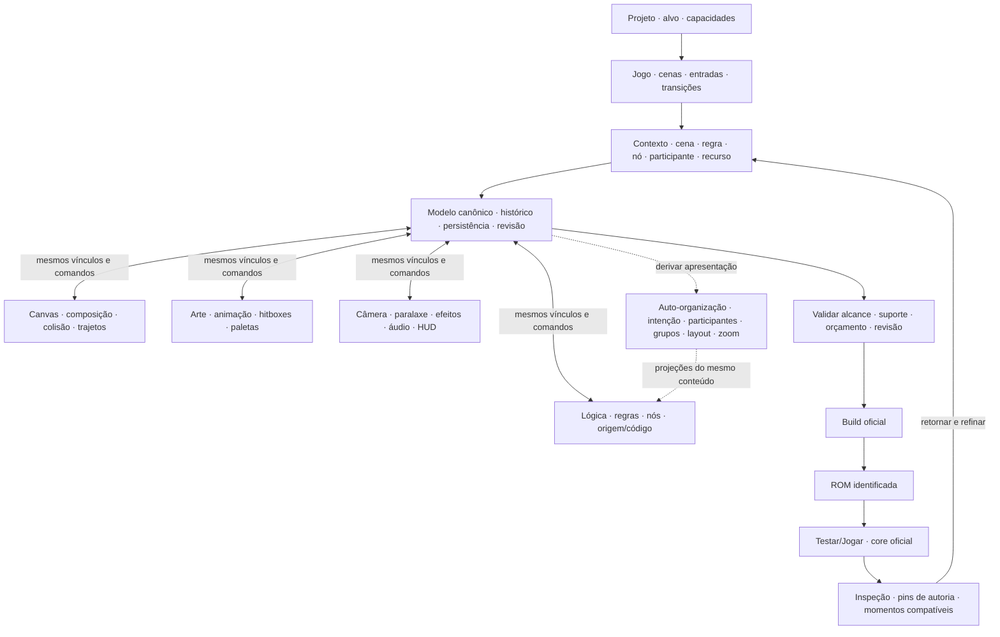

# Plano — auto-organização da lógica na engine/editor

**Status: proposta para validação do operador, antes da implementação.** Pedido de 2026-11-08. Esta entrega contém avaliação, plano e mockups. Nenhuma capacidade abaixo foi implementada por esta tarefa, nenhum projeto de jogo foi reorganizado e nenhuma validação de runtime é inferida das imagens.

## 1. Objetivo e alcance

Acrescentar ao RetroDev Studio uma capacidade de autoria que identifique e organize visualmente a lógica de qualquer projeto compatível a partir dos modelos, nós e relações existentes. A engine/editor deve associar automaticamente **intenção, participantes, gatilho, condição, efeito e origem**. O template de plataforma e o herói são casos de teste e exemplos de exibição; não determinam o algoritmo.

A melhoria pertence ao editor/modelo de autoria do produto. Não requer um segundo motor de execução, um compilador novo ou regras especiais para Player, Nalu, uma ROM, nome de arquivo ou gênero de jogo. “Qualquer projeto compatível” não significa interpretação universal de código arbitrário: o reconhecimento é limitado pela semântica disponível, com desconhecidos explícitos.

Preservar a navegação global à esquerda, a navegação horizontal de contexto, acesso a todas as ferramentas, o grafo completo, parâmetros numéricos, conexões, condições, ramificações, trajetos e liberdade de composição. As vistas propostas são projeções dos mesmos dados. Não transformar o editor em uma lista de cartões que substitua a edição precisa.

**Esclarecimento do operador em 2026-11-08:** a melhoria deve organizar o processo de produção em situações diversas e continuar aberta à composição. Zoom é somente uma forma de leitura. O alcance obrigatório inclui o fluxo completo de cenas do jogo e ações intercambiáveis entre lógica, gráfico específico, Canvas e teste em tempo real, preservando contexto e dados. Os exemplos reconhecidos não formam uma lista fechada de mecânicas permitidas; associação parcial limita o resumo, não o acesso à lógica e às ferramentas já suportadas.

Esta proposta complementa R2/R3 e a direção R5/R7 da [jornada de autoria](JORNADA_MEGA_DRIVE_2026-11-05.md). Sua execução futura deve entrar na frente sequencial vigente, respeitar a [retomada](../handoffs/PROMPT_RETOMADA_COESAO_PRODUTO_2026-10-24.md) e o [prompt integral existente](../handoffs/PROMPT_IMPLEMENTACAO_UX_CONTEXTUAL_R3_2026-11-05.md), após validação deste plano. Não iniciar esta implementação nesta rodada.

## 2. Avaliação da tela real e da base disponível

Referência visual: captura enviada pelo operador, com 37 nós e grupos cujo propósito é difícil de reconhecer no zoom apresentado. Quantidades são da captura, não uma medição nova de execução. A mesma miniatura de personagem aparece em lógicas com funções distintas; os fundos coloridos não explicam quem consulta ou modifica cada participante. A malha pontilhada domina a visão geral e os títulos ficam pequenos.

Na fonte pesquisada, já existem peças úteis:

| Fonte/owner | O que existe | Lacuna a tratar na engine/editor |
|---|---|---|
| `src/core/nodegraph/nodeCatalog.ts` e `nodeDefinitions.ts` | Catálogo único, categorias, ícones, nomes e definição dos nós | Descrever papéis semânticos dos parâmetros/portas de cada tipo suportado: alvo, leitura, escrita, recurso, gatilho e efeito. Não inferir o papel só pelo texto do nome. |
| `src/core/nodegraph/ruleSummary.ts` | Resumos Quando → Se → Fazer, IDs de nós e tratamento explícito de fluxos avançados | Reutilizar e ampliar a projeção para participantes, nomes amigáveis, relações entre regras e origem; não apresentar resumo parcial como completo. |
| `src/core/nodegraph/behaviorLibrary.ts` | Receitas, instâncias, papéis, parâmetros e assinaturas de nós gerados | Usar essas informações como origem declarada das associações, sem recriar receitas ao interpretar a imagem do grafo. |
| `src/core/nodegraph/nodeTypes.ts` | Grupo visual com id, label, nodeIds e collapsed; identidade de nós/arestas | Preservar identidade e metadados de autoria. Resolver separadamente relações derivadas, escopo e personalizações visuais. |
| `src/components/nodegraph/NodeGraphEditor.tsx` | Agrupar, nome sugerido, recolher, mover grupo, enquadrar e navegar para o alvo | O nome sugerido depende da seleção e de heurísticas simples; o cabeçalho reduz altura conforme o zoom. Criar identidade legível persistente e associação automática nos fluxos de construção. |
| `src/core/nodegraph/nodeLayout.ts` | Layout, ocupantes recolhidos, pins, conflitos e `graphSemanticSignature` | Estender a organização incremental por relações/grupos, preservando a defesa já existente de não alterar lógica. |
| `studioContext`, `editorStore`, contexto/origem da entidade e renderer da cena | Seleção, contexto, retorno e apresentação da cena | Ligar regra ↔ participantes sem outro sistema de seleção, outra cena ou carregamento sem limite de assets. |

Observação de fonte: a sugestão atual chega a reconhecer objetivo procurando `goal` no parâmetro e pulo pela presença de velocidade vertical negativa. Isso é útil como ponto de partida, mas não deve virar contrato genérico. Renomear um objeto ou combinar duas regras não pode mudar arbitrariamente a intenção reconhecida.

O workspace contém mudanças de outra frente em fontes de produto e em documentos compartilhados. Elas permanecem preservadas. A leitura começou em `1c5f404f`; durante a avaliação a continuidade avançou a `014e299fad9cc20d1cedef780b4f50be7f219418`. Revalidar o estado antes de qualquer implementação futura. Este plano não certifica essas mudanças.

## 3. Contrato da associação automática

### 3.1 Uma origem, uma projeção

Derivar a descrição do grafo/modelo canônico. A projeção pode ter cache por revisão, mas não é outro grafo de execução nem outra fonte de parâmetros. Usar os resolvers existentes para projeto, cena, grafo, instância/modelo e recurso; não deduzir escopo pela miniatura.

Cada regra/grupo apresenta, quando conhecido:

- **Título de intenção:** ação compreensível, com participante quando útil; título personalizado pelo autor tem precedência.
- **Definida em:** contexto/origem real da regra, distinto dos objetos afetados.
- **Quando / Se / Faz:** gatilho, condições e efeitos sustentados pelo modelo.
- **Afeta:** entidades, recursos, variáveis ou serviços modificados.
- **Consulta / depende de:** entidades, estados, colisão, variáveis e recursos lidos.
- **Origem:** declaração/receita, descrição derivada do grafo ou associação parcial/não confirmada.
- **Identidade navegável:** referências existentes de grafo/nós/grupo para localizar o conteúdo, sem trocar IDs por nomes visuais.

Um grupo pode pertencer à lógica de um personagem e afetar porta, câmera ou áudio. Miniaturas representam os participantes pertinentes, inclusive mais de um; não repetir sempre o sprite dono do arquivo. Áudio, câmera, variável e recurso sem imagem recebem representação do seu tipo e nome, sem inventar um sprite. Ausência de asset não impede identificar a regra.

### 3.2 Precedência de reconhecimento

1. **Origem declarada:** metadados válidos de receita, binding ou modelo de objeto, inclusive dados de trajeto quando esse for o owner. Nomes/participantes são derivados dessa origem conhecida.
2. **Descrição do grafo:** analisar tipos/portas/parâmetros conhecidos e os caminhos de execução/dados. Uma descrição é reconhecida por estrutura e semântica tipada, não por nomes de personagens ou do projeto.
3. **Parcial:** conservar as partes conhecidas e indicar lacunas, múltiplas entradas, participantes indefinidos e efeitos que não podem ser resumidos. Dar acesso ao grafo completo, sem forçar uma classificação.

Origem de uma associação e suporte de execução no alvo são informações distintas. Um trajeto declarado ou nó importado não recebe selo de efeito em runtime só por aparecer num cartão. Não introduzir percentuais fictícios de confiança ou usar animação visual do editor como telemetria do core.

### 3.3 Construção e uso repetido

| Situação | Comportamento planejado |
|---|---|
| Adicionar comportamento conhecido | Criar/atualizar identificação e grupo visual com os participantes e a origem da receita, na mesma ação de autoria. |
| Acrescentar/conectar nó manual | Recalcular a região afetada e atualizar a descrição. Associação incerta fica como sugestão/parcial; não mover nós deliberadamente posicionados por causa de uma hipótese. |
| Renomear objeto/recurso | Atualizar os nomes derivados por identidade. Preservar o título personalizado da regra. |
| Abrir projeto antigo | Oferecer projeção útil imediatamente, sem gravar a lógica ou migrar silenciosamente o projeto. A adoção de organização visual persistida é explícita e reversível. |
| Nó usado por várias regras | Mostrar referências/dependências compartilhadas. Não duplicar o nó ou a execução para que ele caiba em dois cartões. |
| Recolher, dar zoom ou filtrar | Alterar somente a apresentação. Não pausar a lógica, remover caminhos, trocar parâmetros ou reescrever a intenção. |
| Fixar posição ou personalizar título | Respeitar a autoria nas reorganizações seguintes. Uma opção explícita pode voltar ao nome/layout automático. |
| Remover participante ou trocar contexto | Invalidar a associação correspondente, conservar o dado desconhecido e descartar resultados atrasados de outra cena/revisão. |

## 4. Organização espacial e níveis de leitura

**Automático para conteúdo novo:** aproveitar a ação de criação/conexão/receita para posicionar novos blocos na região adequada, evitar sobreposições e estabelecer um título/associação. Reutilizar `layoutNodeGraph`, pins, caixas recolhidas e o histórico existentes.

**Estável para trabalho existente:** a engine não reorganiza tudo a cada tecla, frame, seleção ou rename. Conservar posições manuais/pins. Se um novo bloco não couber sem mexer no trabalho fixado, indicar o conflito e oferecer organizar a seleção/grupo. Organizar tudo continua uma ação explícita com Undo. Não sobrescrever grupos manuais com categorias inferidas.

**Vistas do mesmo grafo:**

- Fluxo do jogo: cenas, entradas, transições, bifurcações, retornos e destinos dinâmicos/pendentes identificados, com acesso ao nó/objeto responsável.
- Visão geral/mapa de regras da cena: intenção, participantes, gatilho/efeito e origem legíveis; busca e minimapa representam grupos com nomes.
- Visão intermediária: condições, ações principais, relações de dados e fronteiras entre grupos.
- Grafo completo/detalhe: todos os nós, campos, portas, ramificações, ciclos e conexões editáveis.

O zoom semântico adapta a densidade de informação; não é gravar `collapsed` ou apagar componentes ao afastar. Cabeçalhos mantêm legibilidade dentro do espaço disponível e a malha perde contraste. Em grafos grandes, priorizar seleção/foco/busca e usar agregação do minimapa; não prometer exibir centenas de títulos simultaneamente em 949×593. Preservar pan/zoom, retorno e acesso a todos os itens. Na implementação, o minimapa deve refletir limites geométricos e a área visível; uma lista navegável de grupos deve ser identificada como índice, sem simular um mapa espacial.

Cores e miniaturas são apoios; a relação textual e os participantes sustentam a compreensão. A vista detalhada mantém precisão. Se nó e Inspector exibirem o mesmo parâmetro, compartilhar o valor/modelo, indicar a superfície ativa de edição e evitar dois drafts concorrentes.

Painéis contextuais mantêm cabeçalho/ícone e acesso visíveis quando recolhidos, com abrir, fixar e restaurar disposição. A seleção determina o conteúdo, sem fechar um campo em edição ou depender apenas de hover; teclado e movimento reduzido têm caminhos equivalentes. Uma miniatura da cena ajuda a orientação; marca d'água atrás do grafo é opcional, com opacidade controlável e desativada quando prejudicar contraste. Referências de exibição como A1/A2 podem acompanhar cena/regra por vínculo estável, sem substituir IDs ou mudar de significado ao reorganizar os nós.

## 5. Navegação entre regra, cena e dados

- Clicar na regra enquadra seu conjunto de nós; abrir detalhe preserva a identidade selecionada.
- Ver participantes na cena destaca exatamente o que a regra consulta/afeta. Não pressupor que é sempre o herói. Escolher entre múltiplos alvos quando necessário.
- Selecionar um objeto na cena permite localizar regras que o modificam e regras que o consultam, com essas relações distintas.
- Busca por título, participante, efeito, recurso e identidade já suportada leva à ocorrência correta, incluindo grafos compartilhados. Não criar outra numeração instável nem misturar instâncias iguais pela aparência.
- A lista Participantes do mockup é um filtro contextual. Não substitui a hierarquia da cena nem a navegação global.
- Relações entre grupos distinguem fluxo de execução e dependência de dados. Uma linha de “lê variável” não se torna uma aresta executável nova.
- Duplo clique abre a edição principal do recurso compatível. Botão direito oferece ações sobre aquela seleção: arte/animação, paleta/usos, lógica/comportamento, Canvas/isolamento e teste, conforme suporte e escopo. O mesmo conjunto tem acesso por teclado e botão de ações; não esconder operações exclusivamente no menu contextual.

O grafo/contexto selecionado é um recorte de trabalho, não o limite de cobertura da entrega. O fluxo integral do jogo e o acesso aos demais grafos fazem parte do aceite. Resolver e carregar de forma progressiva, com escopo e orçamento limitados; mostrar o que está sendo indexado, o que é conhecido e o que está indisponível. Não carregar todos os assets/grafos de uma vez nem usar um índice persistido concorrente para simular cobertura. Lote parcial não conclui esta proposta enquanto esse acesso integral não existir.

### 5.1 Fluxo completo do jogo e das cenas

Oferecer acesso permanente às escalas **Cenas do jogo → Regras da cena → Grafo completo**, sem perder as áreas globais ou a liberdade de abrir outras relações. A escala do jogo representa entradas, cenas de menus/fases/outros tipos compatíveis, bifurcações, retornos, ciclos e encerramentos; não pressupor uma sequência linear de fases. Cada ligação indica sua origem, gatilho/condição e destino quando conhecidos, com navegação para a regra e o nó responsáveis.

Transição declarada, execução suportada no alvo e transição observada em teste são fatos diferentes. Destino calculado, ausente, externo ou não compreendido permanece explícito e inspecionável. A auto-organização não pode eliminar essas rotas nem apresentar só os caminhos reconhecidos como se fossem o jogo completo. O mapa deriva dos modelos/grafos/provenientes existentes; não cria outro executor ou reescreve transições ao mover cartões.

### 5.2 Ações intercambiáveis entre esteiras de trabalho

Uma seleção estabelece vínculo de autoria com projeto/cena/revisão, grafo/nó, participantes, recurso, animação/ocorrência e propriedade espacial pertinentes. O vínculo deve ser resolvido pelo modelo e reutilizar `studioContext`, seleção, retorno, persistência e histórico existentes. A identidade do recurso afetado pode ser diferente da entidade dona do grafo.

| Intenção a partir da lógica | Destino direto planejado | Conservação obrigatória |
|---|---|---|
| Editar o gráfico usado por uma ação | Abrir o asset/variante exatos na Arte; para ação de animação, abrir também o estado/ocorrência correspondente quando conhecidos. | Não abrir sempre o gráfico do dono do arquivo. Se houver vários recursos, oferecer escolha contextual com nomes/miniaturas; escopo compartilhado e usos claros antes de gravar. |
| Editar paleta, áudio ou outro recurso | Abrir o owner/ferramenta apropriados daquele recurso e das ações efetivamente suportadas. | Um recurso global não recebe posição ou sprite fictícios; preservar as operações e limites reais do seu tipo. |
| Posicionar o objeto | Enquadrar e selecionar o participante correto no Canvas, com manipulação visual e entrada numérica sobre a mesma fonte. | Preservar autoria inicial, prioridade/plano, colisão e histórico conforme o campo editado; nome e aparência não substituem identidade. |
| Ajustar posição/destino de uma ação | Abrir no Canvas a alça/vetor/trecho correspondente ao parâmetro da ação, trajeto ou câmera. | Distinguir posição inicial da cena, destino do comando e posição observada em execução. Arrastar o destino de um nó não pode mover silenciosamente o spawn inicial. |
| Testar a partir do contexto | Acionar a sessão oficial do contexto/cena/destino validado, mantendo todos os participantes e dependências. | Identificar revisão, início e ROM; não apresentar um objeto isolado ou ROM antiga como teste atual. |
| Voltar à lógica | Retornar à mesma regra/nó com seleção, pan/zoom, painéis e edição preservados. | Mudanças na Arte/Canvas já aparecem na referência/resumo pertinente, sem duplicar dados ou reiniciar a associação. |

Essas ações devem estar próximas da seleção e disponíveis por teclado. As áreas continuam abertas à navegação livre; o contexto oferece caminhos diretos e retorno, não aprisiona o usuário numa sequência fixa. Em conflito, recurso removido ou resposta atrasada, usar os estados de recuperação existentes, sem trocar o alvo silenciosamente.

### 5.3 Edição e teste em tempo real

O requisito é um ciclo integrado de **editar → observar → testar → ajustar → continuar**, aproveitando a direção R6/Jogar e o core oficial existente. Inclui resposta imediata das ferramentas de autoria, acesso direto ao teste a partir da seleção e experiência de execução na frequência apropriada do conteúdo, com controle/áudio e cadência medidos. Não se reduz a mostrar um arco ou uma animação de prévia.

Definir por propriedade/alvo o contrato de atualização: o que pode ser aplicado ao vivo com confirmação e reversão, o que é apenas prévia de autoria e o que exige preparar/reconstruir/reiniciar a execução pelo pipeline oficial. Essa tabela deve integrar o suporte existente, não criar um segundo runtime. Mudanças estruturais que exijam build usam uma ação integrada de preparação, preservando o trabalho; não pedir que o usuário refaça toda a navegação.

A interface identifica **edição atual**, **execução da revisão identificada**, **alterações pendentes** e **preparando atualização**. Nunca chamar uma prévia de execução real nem uma ROM desatualizada de revisão atual. Não prometer hot reload irrestrito para todo tipo de dado. Atualização ao vivo, quando suportada, deve manter correspondência entre modelo, recurso/runtime, Undo e recibo da revisão; evitar alterações de RAM avulsas sem contrato de autoria.

Os owners de teste incluem shell/comandos, `buildService`, IPC/build canônico, emulador e `runtimeLink`; o último identifica a execução, não substitui o pipeline. Testar ↔ Jogar ↔ editar reutiliza a sessão quando compatível e a recuperação/retorno existentes. A cadência de gameplay e a latência de interação precisam ser medidas no alvo; nenhum selo de tempo real é concedido por um mockup.

## 6. Roadmap em série — da base ao ambiente completo

**Pedido complementar de 2026-11-08:** apresentar a ordem de construção e verificar se ela resulta numa experiência robusta, dinâmica e amigável, com a lógica integral estruturada. A série S00–S10 detalha as etapas 0–5 anteriores e incorpora a cobertura já solicitada em R2/R3/R5/R6/R7. Não substitui os estados operacionais do roadmap canônico nem declara capacidades implementadas por este documento.

### 6.1 Sequência de implementação

A ordem abaixo é de construção da engine/editor. No produto resultante, o usuário pode iniciar por diferentes áreas e alternar livremente entre as esteiras. A passagem de fase exige o aceite correspondente, com as regressões do owner e a jornada afetada; uma retenção não pode ser escondida por uma interface nova.

| Série | O que precisa ser fechado | Experiência de produção resultante | Gate para avançar |
|---|---|---|---|
| **S00 — Conservar e estabilizar** | Conferir capacidades existentes, WIP, bugs abertos, owners, suporte por alvo, recursos do host e evidências. Integrar os fechos já em andamento antes de ampliar as mesmas responsabilidades. | O usuário mantém funções, precisão, projetos e caminhos que já possuía. | Matriz função→acesso→owner→regressão→prova; falhas preexistentes identificadas; baseline correspondente. Não reiniciar o produto do zero. |
| **S01 — Uma base de autoria** | Identidades, escopo, recurso compartilhado, unidades, contexto, persistência, Undo/Redo, revisões e descritores semânticos dos tipos de nó. | Arte, Canvas, lógica e execução referem os mesmos objetos/recursos e os valores corretos. | IDs/legado/overrides preservados, cancelamento sem mutação, conflito/recuperação corretos; descritores independentes de nomes de template. |
| **S02 — Navegação e fluxo do jogo** | Navegação global + contextual; painéis recolhíveis/fixáveis; escalas Jogo→Cenas→Regras→Grafo/origem; entradas, bifurcações, retornos, ciclos e destinos dinâmicos. | Compreender o jogo inteiro, abrir uma ligação, chegar ao seu nó e retornar, com ferramentas descobríveis. | Mapa completo dentro da cobertura declarada, indexação/ausências visíveis, origem e destino rastreáveis; painel em edição não fecha sozinho. Separar declaração, suporte de execução e observação real. |
| **S03 — Compor e manipular no Canvas** | Objetos compatíveis, seleção, transformação, campos precisos, camadas/planos A/B, sprites, prioridade, bloqueio, isolamento, câmera, colisão e regiões de evento; mostrar/atenuar/ocultar por camada e cor na visão de trabalho. | Montar a cena visualmente, selecionar inclusive conteúdo encoberto e ajustar com precisão. | Gesto e número alteram a mesma propriedade/histórico; filtros não mudam gameplay, arte ou paleta; sair do isolamento restaura a visão anterior; escopo de posição inicial/destino/estado observado inequívoco; suporte e granularidade do alvo claros. |
| **S04 — Produzir gráficos e recursos** | Arte/pixels, importação/conversão adequada ao alvo, animação, FPS/loop/onion skin, hit/hurt boxes, eventos de quadro, paletas/bancos/usos/variantes e conjuntos reutilizáveis. | Abrir o recurso específico de uma regra, editar e ver a referência atualizada na composição. | Conversão e recurso canônicos, qualidade visual revista após conversão, escopo compartilhado claro, cancelar/Undo/save/reopen corretos, orçamento e consumidores preservados; não reduzir o painel de paletas a uma faixa decorativa. |
| **S05 — Construir mecânicas e movimentos** | Comportamentos parametrizados, regras, estados/variáveis, gatilhos, interação/combate compatíveis, trajetos por pontos/retas/curvas/elipses, tempo/velocidade/espera/repetição/ida e volta. | Criar mecânicas ricas por gestos e parâmetros, aprofundando nos nós/código quando necessário. | Mesma semântica no Canvas/formulário/nós; origem gerada/manual e regeneração reversíveis; colisão, movimento e comportamento comprovados no alvo declarado. |
| **S06 — Auto-organizar sem limitar** | Identificação de intenção/participantes, grupos automáticos, layout incremental, pins/títulos manuais, zoom semântico, busca e relações de dados/execução. | Ler o conjunto e editar detalhes sem reorganização manual obrigatória ou classificação fechada de mecânicas. | Assinatura semântica preservada em operações visuais; parciais explícitos sem bloquear lógica suportada; layouts/personalizações mantidos; teste em outros projetos e nomes. |
| **S07 — Composição e ferramentas avançadas** | Oclusão/seleção de região, ondas/distorção, Fantasma com técnica explícita, timeline de propriedades/eventos, câmera/paralaxe, animação de paleta/atmosfera e mapa de custos/otimização assistida. | Elaborar gráficos e efeitos, avaliar sua composição e controlar custo/precisão. | Planner e emissores oficiais, limites por alvo, prévia identificada, efeito/restauração e orçamento comprovados; nenhuma troca silenciosa de arte, colisão ou prioridade. |
| **S08 — Conectar as esteiras** | Duplo clique/menu contextual com alternativas acessíveis; ações diretas nó→gráfico/animação exatos→propriedade no Canvas→teste→retorno; acesso livre a toda a produção. | Continuar o trabalho no objeto/recurso certo a partir de qualquer área pertinente. | Vínculo de autoria e escopo corretos, retorno ao mesmo nó/seleção/pan, ausência de draft concorrente ou alvo trocado; ensaio completo entre áreas. |
| **S09 — Testar e jogar continuamente** | Execução oficial em cadência adequada, início/cena/pin, pausa/step, momentos capturados compatíveis, revisão identificada e atualização ao vivo/reconstrução conforme o contrato. | Editar→observar→testar→ajustar→continuar com acesso direto e contexto preservado. | PLAY01–06, pipeline Build→ROM→core e transições realmente suportadas; cadência/áudio/input medidos; rejeição de estado/ROM obsoletos. Nenhuma prévia substitui essa prova. |
| **S10 — Fechar produção repetida e entrega** | Uso prolongado, regressão entre projetos/alvos declarados, acessibilidade, memória/desempenho, salvar/reabrir/recuperar e build/exportação da revisão correta. | Um ambiente confiável para produzir, revisar e entregar repetidamente. | Gates atuais, Tauri em 1366×768 e 949×593, jornadas/critérios humanos pertinentes e artefatos identificados; limitações remanescentes explícitas e maturidade honesta. |

S00/S01 alimentam todas as fases. S02 cria o acesso integral ao jogo; S03–S05 dão conteúdo e mecânicas a esse fluxo; S06 organiza os mesmos dados; S07 amplia produção visual; S08 fecha a continuidade entre áreas; S09 fecha a execução; S10 verifica o conjunto. Capacidade já comprovada é conservada e integrada, com reteste pertinente, não reimplementada por conveniência.

As ações intercambiáveis e a acessibilidade devem nascer em cada fase, mesmo antes de S08/S10. Essas fases verificam a integração completa, não autorizam deixar as anteriores isoladas ou inacessíveis. Uma ferramenta nova já nasce com entrada clara no Canvas/contexto, precisão numérica e retorno. O teste básico acompanha os lotes que o exigem; S09 fecha a experiência contínua de execução e suas diferentes intenções.

### 6.2 Conferência de cobertura das propostas anteriores

| Família já solicitada | Onde entra na série |
|---|---|
| R3-01 escopo e paleta; R3-04 escopo do grafo; R3-05 unidades/input | S01 define o contrato; S04/S05 aplicam; S08 verifica o intercâmbio. |
| R3-02 visão derivada; R3-07 cabeçalho; R3-08 bloqueio | S02/S03 e S06; precisão, descoberta e reversão acompanham a UI. |
| R3-03 gerado/manual; R3-06 referências e origem das transições; R3-09 início de teste | S05/S06; S02/S08; S09, respectivamente. R3-10 mantém mockups/legendas honestos em todas as revisões. |
| R5 autoria robusta, trajetos, plataformas e planos/prioridade | S00 conserva/corrige a base; S03/S05 integram gestos e semântica; S07 compõe; S09/S10 comprovam o conjunto. |
| R6 PLAY01–06: contrato, execução, início/cena, pins, momentos e integração | S01/S02/S03 preparam referências e autoria; S09 fecha execução/compatibilidade; S10 faz uso repetido. Pin autoral não equivale a save state do core. |
| VIS01 inventário; VIS02 paletas; VIS03 primeiro plano/oclusão | S00; S04/S07; S03/S07. |
| VIS04 ondas/distorção; VIS05 Fantasma; VIS06 mesmos dados Canvas/nós/código | S07; S07; S01/S05/S08. Técnica e suporte do efeito são explícitos por alvo. |
| VIS07 seleção/transformação; carimbos/terrenos; colisão/regiões; timeline; câmera; atmosfera/paleta; custos/otimização | S03; S03/S04; S03–S05; S05/S07; S03/S05/S07; S07; S07/S10. As sete famílias permanecem no escopo declarado. |
| VIS08 integração, composição e prova entre capacidades | S08–S10, preservando toda a matriz de acesso, precisão e reversibilidade. |

Cada requisito deve ter status por owner e alvo na matriz canônica, sem um “concluído” global que esconda uma variante não comprovada. Recursos fora dos alvos/fases atuais permanecem identificados conforme o roadmap; desenhá-los não antecipa sua implementação. Se uma transição de cena ou técnica visual necessária não tiver suporte real, a dependência deve ser resolvida ou retida explicitamente antes de anunciar a experiência correspondente como completa.

### 6.3 Jornada de produção que o resultado precisa sustentar

1. Criar/abrir projeto e escolher o alvo, recuperando o trabalho anterior quando pertinente.
2. Estruturar o jogo/cenas e seus caminhos; abrir qualquer regra/transição, inclusive rota parcial/dinâmica.
3. Inserir/importar recursos, compor a cena e manipular objetos/planos/câmera com precisão.
4. Editar o gráfico/animação/paleta específicos, com alcance de recursos compartilhados visível.
5. Construir regras, trajetos, estados, eventos e efeitos, alternando gestos, campos e nós sobre os mesmos dados.
6. Usar a organização automática para localizar intenção/participantes, entrar no grafo completo e personalizar a apresentação.
7. A partir de uma regra, abrir Arte ou Canvas, alterar a propriedade correta, testar o contexto/revisão e voltar sem refazer a navegação.
8. Jogar/inspecionar, capturar/retomar momentos compatíveis e repetir o ciclo de refinamento.
9. Salvar/reabrir, revisar custos/limites e gerar/exportar o artefato da revisão identificada.

Essa sequência é um ensaio de ponta a ponta, não um assistente que obriga o usuário a começar pela cena ou terminar uma área antes de abrir outra. Exemplo de aceite: um nó afeta uma porta diferente do dono do grafo; abrir seu asset, editar a animação, ajustar a posição inicial ou o destino correto no Canvas, testar a cena completa, observar uma transição suportada, voltar ao mesmo nó e recuperar o trabalho após reabrir. Repetir com outro conjunto de objetos/projeto demonstra a capacidade da engine.

### 6.4 Visão lógica consolidada do ambiente

O modelo abaixo descreve relações de autoria/projeção/execução, não cria módulos executores novos. “Modelo canônico” reúne os owners já existentes, sem propor uma store universal que os substitua.

Navegação global e contexto continuam disponíveis em toda a estrutura. Resumo, grupo e minimapa organizam o acesso; o grafo completo e as origens permanecem alcançáveis. Os estados conhecido/parcial, prévia/execução e edição atual/revisão em teste continuam distintos. Implementar em série não transforma a produção em caminho único.

A aprovação visual orienta a implementação dentro da frente sequencial, respeitando fechos em andamento. Não aprova contrato ainda não testado, não muda decisões arquiteturais consolidadas e não concede merge/release/deploy.

## 7. Validação que distingue melhoria da engine de ajuste de template

O template atual entra como **um** caso. O aceite exige também:

1. Grafo com movimento de outro tipo de objeto, sem nomes Player/Hero/Nalu e sem usar imagem como chave semântica.
2. Regra de puzzle/interruptor com leitura e escrita em participantes diferentes; câmera e áudio com efeitos globais identificados.
3. Duas instâncias do mesmo recurso/modelo, regras compartilhadas e overrides, conservando escopo e contagens corretos.
4. Grafo manual com ramificações, ciclos, nós compartilhados e trecho sem semântica conhecida, sem resumo falso, clone de execução ou remoção de caminho.
5. Troca de nomes/IDs/ordem/asset com a mesma semântica e troca de semântica mantendo nomes parecidos, para demonstrar que não se está reconhecendo o template por texto.
6. Casos vazio, carregando, removido, origem externa e imagem ausente, com navegação por teclado e estado compreensível.
7. Jogo de exemplo com menus, bifurcação, retorno/ciclo e destino dinâmico: acessar o mapa completo, abrir a origem de uma transição e voltar sem perder contexto. Cobertura parcial deve continuar visível e impedir declaração de fluxo integral concluído.
8. Partir de um nó que afeta um recurso diferente do dono do grafo → abrir o gráfico/animação exatos → editar → posicionar a propriedade pertinente no Canvas → testar a revisão atual → voltar ao mesmo nó. Conferir escopo compartilhado, Undo/Redo, reabertura e ausência de alvo trocado. Para alterações ao vivo, aplicar o contrato e contraprovas pertinentes; para reconstrução, provar preparação/retorno sem execução obsoleta.

Casos sintéticos de unidades verificam a projeção; projetos autorais compatíveis e a jornada Tauri verificam uso real. Isso não autoriza anunciar suporte a um jogo/gênero/alvo inteiro.

Invariantes: organizar/navegar/zoom não muda a assinatura semântica; associação não confirmada não é apresentada como certeza; nomes personalizados e pins sobrevivem; nós compartilhados não se duplicam; resposta de outra revisão não é aplicada. A assinatura existente deve ser auditada quanto à cobertura dos metadados novos, e não substituída por uma comparação que ignore mudanças relevantes.

Medir análise por revisão, número de recálculos, tempo de interação/layout, memória e legibilidade, com conjuntos representativos de 37, 200 e 1000 nós. Esses tamanhos são cenários propostos, não benchmarks executados. Usar invalidação por revisão/participantes e carregamento limitado; não analisar o grafo a cada frame do emulador ou movimento de mouse. Registrar comparação com a linha de base e definir limites de desempenho a partir dessa medição, sem selo antecipado de 60 FPS.

No Tauri, validar 1366×768 e 949×593, tema/zoom apropriados, foco, teclado, nomes acessíveis, contraste real e movimento reduzido. Painéis contextuais podem recolher/encaixar, mantendo a navegação global e os acessos claros. Verificar ida/volta, edição repetida, Undo/Redo e reabertura. Para a parte puramente visual, comprovar conservação de nós/parâmetros/arestas. Se o incremento alcançar build/runtime, aplicar também Build→ROM→core e host:certify conforme AGENTS; não transferir prova de MD para outro alvo.

Avaliação humana proposta: localizar qual regra move um objeto, qual altera outro participante e qual depende de uma variável; entrar no nó correto e retornar. Comparar ações, hesitações e erros com a tela atual. Não há resultados humanos medidos nesta entrega.

## 8. Retenções antes da implementação

- Validar o roadmap em série e as quatro vistas complementares: mapa de regras, grafo editável, fluxo do jogo e ambiente consolidado. A distinção entre resumo e edição completa deve permanecer clara.
- Fechar escopo por origem/participantes, tratamento de nós compartilhados e coexistência de grupos manuais/derivados. Agrupamento visual atual tem uma participação exclusiva por nó; a projeção de regras pode referenciar o mesmo nó sem alterar esse contrato ou duplicá-lo.
- Confirmar quais novos metadados são derivados, quais são preferências de editor e quais precisam de serialização compatível; preservar projetos antigos sem reescrita automática.
- Definir comportamento em ambiguidade, branches/ciclos e código importado. Semântica não conhecida não pode ser inventada por nomes, cores ou proximidade.
- Não usar o mockup para atribuir execução a um nó ou tipo de objeto sem suporte no alvo. Telemetria de execução real, se futuramente exibida, precisa de prova separada.
- Resolver carregamento/indexação e proveniência de transições para o fluxo completo, inclusive rotas desconhecidas; não fechar o item entregando apenas o grafo selecionado ou um conjunto fixo de mecânicas.
- Fechar o vínculo exato nó/recurso/propriedade e a política de edição/teste ao vivo versus reconstrução, mantendo uma origem e a identificação da revisão. A posição autoral, o destino de uma ação e o estado de runtime não são campos intercambiáveis sem intenção explícita.
- Resolver medições e limites no host antes de validar desempenho. Respeitar o protocolo de recursos, locks, bootstrap e a revisão atual do Memory Bank; nenhum build/teste pesado é necessário para aprovar esta proposta visual.

## 9. Mockups e limites desta entrega

Artefatos privados em `/home/misael/Shared/ProjectRuntime/RetroDevStudio/sessions/plano-auto-organizacao-logica-20261108/`:

- `01-mapa-regras-engine.png`: visão geral com participantes diversos e origens declarada/derivada/parcial.
- `02-grafo-completo-engine.png`: detalhe com nós, campos, portas, condições e relações; preserva a navegação global e as áreas relacionadas.
- `03-fluxo-jogo-esteiras.png`: fluxo integral de um jogo ilustrativo com bifurcação, retorno e destino dinâmico, mais ações diretas sobre o recurso específico para Arte, Canvas, nó de origem e teste. Não representa transições já compiladas ou sessão rodando.
- `04-logica-completa-ambiente.png`: síntese visual do ambiente proposto, com acesso ao fluxo do jogo, índice contextual aberto, grafo editável, trajetos e ações sobre o recurso exato. Os grupos recolhidos conservam o acesso; o desenho é um recorte ilustrativo e não um inventário de todos os nós ou capacidades implementadas.
- `entrada-tela-real.png`, `prompts.json` e `manifesto.json`: referência fornecida, prompts imagegen e identidades dos arquivos.

As imagens são composições ilustrativas; conteúdos, contagens e valores são exemplos, não exportação reagrupada do projeto do operador. Os auxiliares Sem ação representam portas sem ligação, não operações novas. A intenção da vista detalhada é mostrar capacidade preservada, não certificar que todas as regras/parametrizações daquele exemplo foram compiladas. A miniatura do personagem é apenas um recurso visual ilustrativo e não uma condição do algoritmo. No ambiente consolidado, X/Y são a posição inicial da Porta; o destino de transição é a Cena C, em um campo distinto. O índice de grupos não simula um minimapa geométrico. Campos e ações não garantem suporte no runtime sem o gate pertinente.

Geração por imagegen embutido. As imagens selecionadas usam a arte original do mensageiro como ilustração e indicam proposta sem execução, sem selo de validação de runtime. Os originais da geração e prompts permanecem preservados. Nenhuma imagem sintética é evidência de Tauri, acessibilidade ou runtime. Cópias no mesmo filesystem, sem backup independente qualificado.

Diagnóstico fresco pelo launcher global: READY no recibo `sessions/2026-11-08T03-35-40-117Z-481326`. Não executados nesta etapa: build, suítes de produto, Tauri interativo ou provas de jogo, pois o pedido é avaliar e planejar antes de implementar. RAM disponível observada cerca de 3,5 GiB, sem atividade de swap na amostra final e PSI de I/O imediato zerado; nenhuma carga pesada foi adicionada. Orçamento de artefatos locais até 20 MiB, sem SDK/ROM/download grande.

## 10. Proposta de checkpoint para o Memory Bank

Os documentos compartilhados de estado já têm alterações de outra frente. Para preservá-las, esta tarefa propõe a integração posterior do seguinte checkpoint, sem modificar/stagear esses arquivos:

> 2026-11-08 — Auto-organização da lógica na engine/editor: operador pediu avaliação/plano e mockup antes da implementação. Plano em `studio_grafico/PLANO_AUTO_ORGANIZACAO_LOGICA_ENGINE_2026-11-08.md`, com associação genérica por semântica/origem/participantes, layout incremental e zoom legível, preservando o grafo completo e a navegação global. Roadmap serial S00–S10 e matriz de cobertura R3/R5/R6/R7; quatro mockups privados e prompts em `sessions/plano-auto-organizacao-logica-20261108/`. Proposta aguardando validação; nenhum produto/projeto de jogo alterado por esta tarefa. Revalidar estado/owners e os contratos de grupos/escopo/persistência antes de implementar, dentro da frente sequencial vigente. Não anunciar reconhecimento universal nem capacidade de runtime por imagem.

> Complemento do operador: cobertura aberta a diversas situações, acesso integral às transições de cenas e esteiras intercambiáveis. Partir da lógica para editar o gráfico específico, posicionar a propriedade correta no Canvas, testar no contexto/revisão atual e retornar. Atualização ao vivo e reconstrução têm contratos por recurso/alvo, sem confundir prévia e execução. Esses são requisitos de fechamento da proposta, não acessórios do zoom.

Próximo passo desta tarefa: receber a validação/ajustes do operador sobre o roadmap em série e as quatro vistas complementares. A implementação permanece pendente dessa validação explícita, conforme o pedido. Os esclarecimentos sobre abrangência, fluxo de cenas, intercâmbio das esteiras e sequência de produção foram incorporados ao plano; não equivalem a uma autorização para iniciar código nesta rodada.
